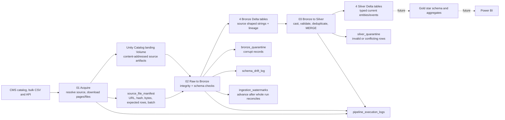
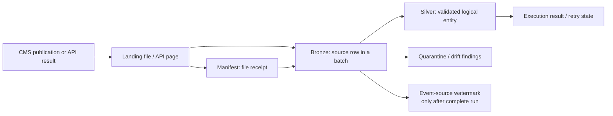
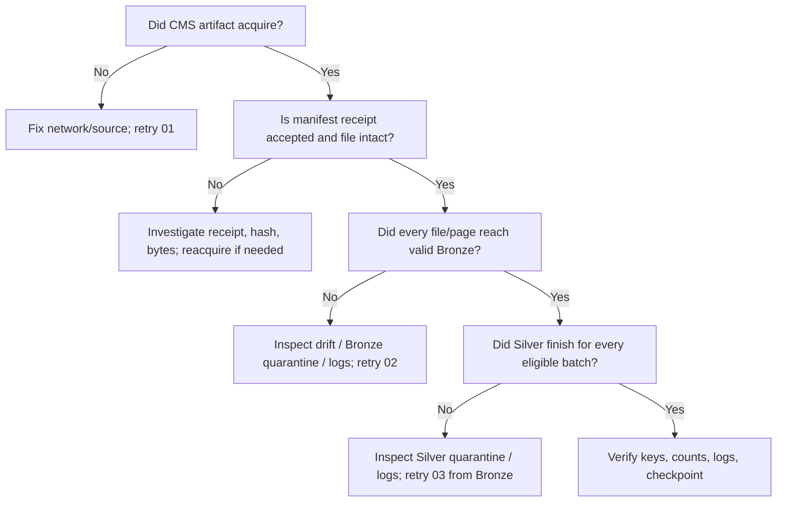

# CareWatch — Complete Evaluation Viva Guide

**Prepared:** 17 October 2026 (Asia/Karachi)  
**Repository:** `D:\Study\Data Analysis & Visualization\Project\us-healthcare-warehouse`  
**Code snapshot reviewed:** `main` at `64a2256`, plus the working-tree files present on 17 October 2026  
**How to use this guide:** Read Sections 1–4 for the story, Sections 5–8 for the code, Sections 9–11 for a trial run, and Sections 12–15 for production, limitations, and viva practice.

> **Evidence labels matter.** “Implemented” means the behavior is present in the inspected code. “Observed on 17 Oct” means the saved-output notebook generated by a successful Databricks job on that date records the result; it is a point-in-time result, not a standing guarantee. “Planned” means it appears in the proposal or README but is not implemented in this # CareWatch — Complete Evaluation Viva Guide

**Prepared:** 17 October 2026; Sections 5–16 revised 21 October 2026 (Asia/Karachi)  
**Repository:** `D:\Study\Data Analysis & Visualization\Project\us-healthcare-warehouse`  
**Code snapshot reviewed:** `main` at `64a2256`, plus the working-tree files present on 17 October 2026  
**How to use this guide:** Sections 1–4 give the overview; Sections 5–11 explain the data journey and tables; Sections 12–13 guide trial runs and demonstration; Sections 14–16 cover production and viva practice.

> **Evidence labels matter.** “Implemented” means the behavior is present in the inspected code. “Observed on 17 Oct” means the saved-output notebook generated by a successful Databricks job on that date records the result; it is a point-in-time result, not a standing guarantee. “Planned” means it appears in the proposal or README but is not implemented in this repository. The direct SQL warehouse was stopped during preparation, but the new evidence artifact contains Spark SQL results from Databricks.

## 1. The answer you can give in 90 seconds

“CareWatch is a data engineering project for analysing quality and regulatory performance of U.S. Medicare and Medicaid certified nursing homes. We collect four public CMS datasets: facility profiles, health inspection deficiencies, penalties, and MDS resident quality measures. The facility identifier, CCN, lets us relate them. Databricks lands the official CMS files or API pages in a Unity Catalog Volume, registers each source artifact in a manifest, copies valid source shaped data into Bronze Delta tables, then converts and validates it into Silver Delta tables. Silver uses deterministic business keys, row hashes, quarantine tables, and Delta MERGE so retries do not duplicate facilities or events. A Bronze watermark controls the next API date window; a separate Silver batch status allows a failed Silver step to retry without downloading again. Gold star schema tables and Power BI are the planned next phase, not current deliverables. Today the project proves the ingestion and cleansing architecture; it is not yet an operational production service.”

A useful shorter line: **CMS source → landed, registered files → Bronze source history → Silver trusted entities → planned Gold analytics → planned Power BI.**

CareWatch is a **decision support** tool. A high deficiency count is a signal for investigation, not a medical judgment that a facility is “unsafe.” CMS reporting definitions, facility size, time period, and data lag all affect interpretation. See `README.md` lines 1–7 and `docs/data_analysis_project_proposal.md`.

## 2. What is actually built today?

| Area | State on 17 Oct 2026 | What to say in the viva |
|---|---|---|
| Four CMS sources and strategy registry | **Implemented** | All four datasets are configured centrally in `src/carewatch/config.py`. |
| Landing and manifest | **Implemented** | CMS bulk CSV and API pages are saved to a Volume with hashes, sizes, counts, and source metadata. |
| Bronze | **Implemented** | Four source shaped Delta tables, batch lineage, schema drift handling, and Bronze quarantine. |
| Silver | **Implemented** | Four typed Delta tables, validation, privacy treatment, deduplication, quarantine, and MERGE. |
| Control and audit | **Implemented** | Manifest, logs, watermarks, drift log, two quarantine tables. |
| Databricks proof | **Observed on 17 Oct** | Tracked `docs/evidence/phase2_live_outputs.ipynb` has generated saved-output cells for representative Bronze/Silver schemas, all eight table counts/timestamps, no-op replay, drift, quarantine, and full/incremental logs, ending in “All Phase 2 evidence checks passed.” |
| Gold star schema | **Planned** | Tables and business metrics are described, but no Gold build code exists here. |
| Power BI report | **Planned** | No dashboard artifact or report is in the repository. |
| Scheduled production workflow, CI, tests | **Not packaged here** | Four evidence/demo jobs exist in the connected workspace, but no tracked production job definition or project-owned test suite was found. |

The proposal is an **early design**, not a record of what was deployed. For example, it describes Gold and Power BI and gives approximate source volumes. The current README (lines 508–521 and 688–705) is clearer about the Phase 2 boundary and passing saved evidence.

## 3. The data model: four source grains

**Grain** means what one row represents. Learn this before discussing joins.

| CMS dataset / ID | One source or Silver row approximately represents | Incremental strategy | Bronze → Silver | Silver entity key |
|---|---|---|---|---|
| Provider Information / `4pq5-n9py` | One facility’s current published profile | New full bulk snapshot; compare rows | `bronze_nh_provider_info` → `silver_facility` | CCN |
| Health Deficiencies / `r5ix-sfxw` | One inspection citation for a facility and survey | Date-filtered API window on `survey_date` | `bronze_nh_health_deficiencies` → `silver_deficiency` | CCN + survey date + survey type + deficiency prefix + tag + inspection cycle |
| Penalties / `g6vv-u9sr` | One fine or payment-denial event | Date-filtered API window on `penalty_date` | `bronze_nh_penalties` → `silver_penalty` | CCN + penalty date + penalty type + fine ID + denial start date |
| MDS Quality Measures / `djen-97ju` | One facility, measure, resident type, and measure period | New full bulk snapshot; compare rows | `bronze_nh_mds_quality` → `silver_mds_quality` | CCN + measure code + resident type + measure period |

The **CCN is a common facility join key**, but it is **not** the primary key of the deficiency, penalty, or MDS fact tables. One facility can have many citations, penalties, and measures. Directly joining all three event tables on CCN multiplies rows and inflates counts. A Gold model should aggregate each fact to a compatible grain before combining metrics. For example, compute deficiencies per facility per year and penalties per facility per year separately, then join those aggregates to a facility dimension.

Provider is modeled as **SCD Type 1** in Silver: a changed facility profile overwrites the prior business state. Bronze retains batch history, but Silver does not have `valid_from`/`valid_to` facility versions. Therefore, a time trend of historical staffing or ownership cannot be reconstructed from `silver_facility` alone without explicitly using historical Bronze snapshots or building a snapshot/history fact. This is a strong viva point.

The dataset IDs, strategies, table names, and ordered business keys are in `src/carewatch/config.py` lines 28–87. The typed contracts and validation metadata are in `src/carewatch/schemas.py`.

## 4. The architecture in one picture



If your Markdown viewer does not render Mermaid, read the diagram left to right: acquisition writes files and manifest; Bronze reads only registered files; Silver reads accepted Bronze batches; logs and quarantine explain failures; Gold and BI are future consumers.

### Why these layers exist

- **Landing Volume:** Keeps the exact received artifact, so the team can replay or prove what CMS sent. A manifest row is its shipping receipt. A file merely present in the Volume is not eligible for Bronze unless the manifest says it was acquired successfully.
- **Bronze Delta tables:** Preserve source columns as nullable strings and add `_dataset_id`, `_source_file`, `_source_file_sha256`, `_batch_id`, `_load_type`, `_ingest_date`, and `load_timestamp`. This captures batch lineage and avoids prematurely deciding whether “1,234,” a blank, or a date is valid.
- **Silver Delta tables:** Hold typed, normalized, validated analytical entities. They contain deterministic entity keys, `row_hash`, source lineage, `is_deleted`, and `load_timestamp`. They are the safe foundation for Gold.
- **Control tables:** Let operators answer “what arrived?”, “which batch was processed?”, “where did it fail?”, and “what date should the next API window start from?”
- **Quarantine:** Keeps rejected records and failed rules for repair and audit, while allowing acceptable rows to continue where the contract permits it.

**Unity Catalog naming:** `carewatch.pipeline.silver_facility` means catalog `carewatch`, schema `pipeline`, table `silver_facility`. The landing path default is `/Volumes/carewatch/pipeline/landing`. The demonstration uses separate schema `carewatch.phase2_demo`. The project uses managed Delta tables; it does not maintain a separate relational database server.

## 5. The mental model: what moves, and what identifies it

Think of the pipeline as **a data path plus a control path**. The data path is CMS → landing artifact → Bronze row → Silver entity. The control path is the manifest, logs, watermark, drift log, and quarantine records that decide whether the next movement is safe and explain what happened.



Four identifiers answer four different questions:

| Identifier | Question it answers | Scope |
|---|---|---|
| `cms_certification_number_ccn` (CCN) | Which nursing home? | Shared across the four datasets. |
| `acquisition_run_id` | Which attempt collected this dataset from CMS? | One dataset-level acquisition; an API run can contain many pages. |
| `batch_id` | Which exact landed file or API page produced these Bronze rows? | The replay and lineage unit. It includes source identity and load context. |
| Silver entity key (`facility_key`, `deficiency_key`, `penalty_key`, `mds_key`) | Which logical facility, citation, penalty, or measure-period? | The MERGE identity; independent of a file or run. |

A **file** is the received artifact; a **manifest row** is the pipeline's receipt for it. A file on the Volume without an accepted manifest receipt is not automatically processed. One full CMS CSV is normally one batch. An API response is split into pages of at most 500 records, each with its own landed JSON artifact, batch, and manifest row. A batch can therefore contain many business rows; a run can contain many batches.

Three dates should never be conflated: an **event date** (`survey_date` or `penalty_date`) says when the real-world event happened; CMS `processing_date` says when the source processed the record and helps prevent stale updates; `load_timestamp` says when this pipeline wrote it. The **watermark** is the last fully committed *source extraction window* for the event datasets, not the newest Silver row date and not a timestamp on a file.

`row_hash` is different from an entity key. The entity key says “same logical thing.” The row hash says “same retained business values.” A repeated record with the same key and hash is a no-op in Silver. A newer record with the same key but changed hash may update that one Silver row. Bronze retains both source appearances in separate batches. A deliberate Bronze reprocess can replace rows of the *same* batch; unrelated batches remain.

**Status words:** `SUCCESS` means the stage completed for its unit of work; `SKIPPED_ALREADY_ACQUIRED` means an existing landed artifact was reused; `QUARANTINED_PARTIAL` means acceptable rows progressed while some were rejected; `FAILURE` means that stage failed. Reusing landing bytes does not guarantee every downstream stage is skipped: a later `incremental` Provider/MDS run can have a distinct batch identity from the earlier `full` run even for the same publication. Silver still compares entity keys and hashes and should make unchanged rows a no-op.

## 6. Which notebook reads and writes what?

Run the normal pipeline in this order: **`00` → `01` → `02` → `03`**. The first two digits are stages, not table names. All paths in this section are relative to the repository root.

| Notebook | What it reads / needs | What it changes | What it does not do |
|---|---|---|---|
| `notebooks/00_setup_tables.ipynb` | Catalog, schema, Volume names; Unity Catalog creation rights. | Creates/verifies the catalog, schema, landing Volume, six operational tables, and four Silver table contracts. | Does not contact CMS or populate data. Four Bronze tables appear on first successful Bronze writes. |
| `notebooks/01_acquire_cms.ipynb` | Four-dataset registry, CMS catalog/download or API, existing event watermarks for incremental mode, `landing_root`. | Lands bulk CSVs or API JSON pages; writes `source_file_manifest` and CMS-to-Landing execution logs. | Does not populate Bronze/Silver or advance watermarks. |
| `notebooks/02_raw_to_bronze.ipynb` | Accepted manifest rows and their exact landed files; chosen dataset/load type/run filters. | Verifies artifacts, writes four Bronze tables, Bronze quarantine and drift findings, per-batch logs, manifest validation fields; advances event watermarks only after complete run reconciliation. | Does not curate Silver. |
| `notebooks/03_bronze_to_silver.ipynb` | Eligible Bronze batches, manifest/log state, current Silver contracts, and address-secret **scope/key names**. | Casts/validates/deduplicates and MERGEs into four Silver tables; writes Silver quarantine and logs. | Does not fetch CMS, rewrite Bronze, or advance source watermarks. |

Other notebooks have narrower purposes:

- `04_migrate_silver_quarantine.ipynb` handles a one-time older five-column to current eight-column quarantine-table migration. It is **outside** the normal run. Its modes are preview, prepare, verify, activate; saved notebook output does not prove today's live migration state.
- `98_prepare_drift_demo.ipynb` creates a two-row **synthetic** Provider file and manifest row in an isolated schema; then `02` and `03` process it. This proves drift/quarantine behavior, not CMS network acquisition.
- `99_demo_idempotency_drift_backfill.ipynb` displays scoped manifest, counts, logs, drift, quarantine, and watermark evidence. It is a viewer; it does not rerun a batch.
- `99_phase2_submission_evidence.ipynb` checks/display assertions against already-populated production and demo tables. It is an evidence checker, not a processor.
- `99_export_phase2_evidence.ipynb` queries live Databricks tables and builds a saved-output notebook. The committed `docs/evidence/phase2_live_outputs.ipynb` is **generated from live Spark SQL results**, not an original UI export of `01`–`03`.

The conceptual division in `src/carewatch/` mirrors this journey: `config.py` defines the four sources; `schemas.py` defines field contracts; `acquire.py` lands; `bronze.py` verifies and preserves; `silver.py` curates; `audit.py` defines receipts/logs/quarantine; `watermarks.py` handles source checkpoints; `drift.py` explains schema change. The notebooks supply parameters and call these components. `README.md` is the runbook and generated table dictionary; `docs/data_analysis_project_proposal.md` describes the larger goal. Local `data/samples/` and `initial_ingestion_samples/` are development/profiling material, **not** the Databricks full-load input. `scripts/refresh_readme_models.py` updates README model listings after a schema change; it is not a data stage.

## 7. Follow a first full load from zero to usable Silver

This is the bootstrap path. Suppose the target namespace is `carewatch.pipeline` and the Volume is `/Volumes/carewatch/pipeline/landing`. Keep the same namespace through all notebooks. `01` has an independent `landing_root` setting; if you use a different catalog/schema, point it at that namespace's Volume too.

### 7.1 Setup: create destinations, not records

Run `00_setup_tables`. It establishes the landing area, operational controls, and empty Silver contracts. There are no CMS source rows yet. This step matters because later stages need known table shapes and an agreed namespace. It will not create the four Bronze tables until there is accepted source data to write.

### 7.2 Acquire: CMS becomes registered landing artifacts

Run `01_acquire_cms` with `load_type=full`. For each of the four configured CMS dataset IDs, it discovers the current official bulk CSV publication, streams that CSV into the landing Volume, and records a manifest receipt. There is a separate `acquisition_run_id` for each dataset. A successful full run typically has one file/batch per dataset, but that is a property of this acquisition strategy, not a rule of the table model.

At this point you should be able to trace, for example, Provider Information like this:

```text
CMS dataset 4pq5-n9py
  → published Provider Information CSV
  → /Volumes/.../landing/... CSV
  → source_file_manifest receipt
      dataset=provider_info
      load_type=full
      acquisition_run_id=<provider run>
      batch_id=<that CSV batch>
      landing_path / source URL / SHA-256 / bytes / status
  → CMS-to-Landing entry in pipeline_execution_logs
```

The other receipts correspond to Health Deficiencies (`r5ix-sfxw`), Penalties (`g6vv-u9sr`), and MDS Quality Measures (`djen-97ju`). **No Bronze or Silver row exists merely because acquisition succeeded.** The manifest is also what lets a later stage distinguish accepted artifacts from stray files.

### 7.3 Bronze: registered artifacts become source-shaped rows

Run `02_raw_to_bronze` with `dataset=all`, `load_type=full` and no run/file filter. It selects successful manifest receipts, rechecks each landed file's bytes and SHA-256, inspects the CSV header, then parses rows against the declared source columns. It keeps source values as nullable strings, even when a field represents a date, rating, amount, or yes/no flag. It adds seven lineage fields, including dataset ID, file, file hash, batch ID, load type, ingestion date, and load timestamp.

Each accepted Provider row goes to `bronze_nh_provider_info`; each citation to `bronze_nh_health_deficiencies`; each penalty to `bronze_nh_penalties`; and each quality-measure row to `bronze_nh_mds_quality`. A malformed CSV row can go to `bronze_quarantine`. A compatible new column is logged as drift and may be retained in Bronze; missing required/ambiguous fields reject the affected artifact instead of silently misaligning columns.

The notebook then reconciles **the whole acquisition run**, not just one successful file: expected artifacts/pages, status, source row counts, and committed Bronze results must agree. For Health Deficiencies and Penalties, a complete full run initializes their Bronze source watermark to that run's as-of date. Provider and MDS have no event API watermark. A partial/quarantined event run does not move its watermark, even if some accepted rows entered Bronze.

**Watch the result display:** `02` currently prints file failures/incomplete reconciliation but does not raise at the end. A green notebook task is not enough evidence that every dataset completed. Read the reconciliation output, execution logs, and watermark table.

### 7.4 Silver: source history becomes curated logical rows

Run `03_bronze_to_silver` with `dataset=all`, `load_type=full`, empty selection filters, `reprocess=false`, and `allow_soft_deletes=false`. Supply the *names* of the Databricks Secret scope and key containing a stable private salt. The secret value must stay out of widgets, Git, and logs.

Silver selects eligible Bronze batches with accepted rows. It trims/normalizes text, turns blanks into nulls, casts dates/numbers/booleans, applies field and cross-field rules, and computes each logical entity key and business row hash. Invalid casts, missing required keys, out-of-range values, and conflicting same-key rows go to `silver_quarantine` with the failed rules. Exact duplicate rows collapse. Plain telephone, street address, and the redundant location field are not published to Silver; a salted address hash may be retained with city/state/ZIP.

New entity keys are inserted. For an existing key, the same business hash means no change. A changed row can replace the current Silver values only when its CMS processing date is present and at least as recent as the current one. `silver_facility` therefore holds one current profile per CCN; the other Silver tables hold one current version **per citation, penalty, or measure-period key**. They can contain many rows for a facility across events and periods. Silver writes its own execution logs and does not change the source extraction watermark.

A clean end state is four populated Bronze tables, four populated Silver tables, manifest/log lineage from source to target, and event watermarks for Deficiencies and Penalties. Bronze and Silver row totals need not match: Bronze preserves batches and duplicate source appearances; Silver resolves logical keys and quarantines invalid rows.

## 8. Follow the recurring incremental load: two very different paths

Run `01`, `02`, then `03` again with `load_type=incremental`. Here “incremental” describes how the **target state** is updated. It does not mean every source extract is small.

### 8.1 Health Deficiencies and Penalties: dated event windows

These datasets have useful event dates: `survey_date` and `penalty_date`. `01` reads the **last complete Bronze watermark** for each. The next inclusive CMS API request starts at that date minus the default 60-day overlap and ends at the current UTC date. For example, if a committed watermark were 10 October, an illustrative next window would start around 11 August and end on the run's current UTC date. The overlap intentionally reacquires recent events so late CMS additions/corrections can be picked up. It is a bounded correction window; changes older than that require a deliberate backfill/replay strategy.

`01` asks CMS for the count and fetches pages of 500 rows. Each page becomes a JSON landing artifact and its own manifest row, including its date window, page offset, expected run count, rows in that page, path, digests, and batch ID. If an exact complete window was already acquired, the notebook can reuse it without another API call. If an earlier complete acquisition is still waiting for Bronze, it stops rather than stacking a newer window over unfinished work.

`02` validates every registered page's envelope and file, writes accepted rows into the corresponding Bronze table, and checks that page offsets/counts cover the expected whole run. **Only then** does the watermark move to the window end. A missing page, failed file, or partial quarantine leaves the old checkpoint in place. `03` then MERGEs these Bronze rows into Silver. Events seen again in the 60-day overlap have the same logical key; unchanged ones are no-ops, corrected newer ones update, and newly reported ones insert. Silver may lag Bronze without invalidating the completed extraction checkpoint because the durable Bronze batch is still there to process.

```text
Prior complete Bronze watermark
  → API date window with 60-day overlap
  → page 0, page 500, page 1000, ... in landing + manifest
  → all pages verified / row counts reconciled in Bronze
  → source watermark advances
  → Silver inserts, updates, or ignores repeated event keys
```

### 8.2 Provider and MDS: publication snapshots

Provider Information and MDS Quality Measures do not use the event-date API checkpoint. `01` looks for the current published **bulk CSV** and can reuse unchanged landing bytes. A newly published snapshot is acquired as a whole: thousands of rows may land and enter Bronze again. `02` keeps that snapshot's rows as another source batch. `03` compares each logical entity's row hash and processing date with current Silver: a new facility/measure-period inserts, a changed newer row updates, and an unchanged row does nothing.

Thus Provider/MDS “incremental” can still read an entire new file. Their target writes are selective. A Provider row for a CCN is a current-state replacement, not a new historical version in Silver. A newly appearing MDS measure period creates a new `mds_key`, while a correction to the same measure period can update the existing key.

The absence of a facility from one publication is **not automatically a deletion**. `allow_soft_deletes` is off by default. Even when explicitly enabled, the code only considers a newest, complete, nonempty, clean bulk snapshot under strict scope and processing-date checks. An API date window is never a safe basis for “missing means deleted.”

### 8.3 Why you may see more Bronze than Silver

Imagine two full Provider publications containing the same 14,690 facilities. Bronze can hold ~29,380 source rows across two batches; Silver still holds about 14,690 current facility entities. This is expected, not 14,690 rejected rows. The saved 17 October evidence shows exactly 29,380 Bronze Provider rows and 14,690 Silver facilities at that point. Interpret counts with **batch grain versus entity grain** before calling a difference a quality issue.
## 9. Table atlas: all 14 implemented tables

All table names below are in the selected Unity Catalog namespace, for example `carewatch.pipeline.<table>`. There are **4 Bronze + 4 Silver + 6 operational** tables. Landing files in the Volume are files, not tables. The proposed Gold objects in Section 14 do not yet exist.

### 9.1 Four Bronze tables: what did this source row say in this batch?

Every Bronze table contains the declared CMS source columns as **nullable STRING**, plus the same seven pipeline-owned fields: `_dataset_id STRING`, `_source_file STRING`, `_source_file_sha256 STRING`, `_batch_id STRING`, `_load_type STRING`, `_ingest_date DATE`, and `load_timestamp TIMESTAMP`. Source-looking dates and amounts are still strings here. A new compatible CMS field may be added to Bronze and recorded in the drift log. Bronze has no enforced one-row-per-business-key constraint: duplicates and repeated snapshots can be valuable evidence.

| Bronze table | Source shape and row meaning | Important source field families |
|---|---|---|
| `bronze_nh_provider_info` | 102 declared CMS fields; one published facility profile row **within one batch/publication**. The same CCN may appear in later batches. | CCN, name/contact/address/geography; ownership/chain; certified beds/residents; Five-Star ratings; staffing/turnover; survey-cycle and penalty summaries; geo/processing date. |
| `bronze_nh_health_deficiencies` | 24 fields; one source citation tied to a facility survey. | CCN; survey date/type; deficiency prefix/category/tag and description; scope/severity; correction fields; inspection cycle and inspection flags; processing date. |
| `bronze_nh_penalties` | 14 fields; one source fine or payment-denial event. | CCN; penalty date/type; fine ID and amount; denial start and duration; provider/geography; processing date. |
| `bronze_nh_mds_quality` | 23 fields; one facility quality measure for a resident group and measure period in a publication. | CCN; measure code/description, resident type, period; Q1–Q4 scores/footnotes, four-quarter average, Five-Star-use flag; processing date. |

The candidate business identity from Bronze is not necessarily unique inside one source file. Silver validates and forms it. For citations the identity uses CCN + survey date/type + prefix/tag + inspection cycle; for penalties CCN + penalty date/type + fine ID + denial start; for MDS CCN + measure code + resident type + measure period; for Provider just CCN. The seven lineage fields tell you which CMS artifact supplied any Bronze row.

### 9.2 Four Silver tables: the current accepted version of each logical thing

Every Silver table contains its entity key, CCN, curated business fields, and common lineage: `row_hash STRING`, `is_deleted BOOLEAN`, `source_file STRING`, `source_file_sha256 STRING`, `source_batch_id STRING`, `source_processing_date DATE` (nullable), and `load_timestamp TIMESTAMP`. Silver names and types are explicit contracts. Entity keys are deterministic hashes used by MERGE; do not describe them as database-enforced primary or foreign keys. Plain telephone, plain street address, and `location` are excluded. `provider_address_hash` may be present; city/state/ZIP remain.

| Silver table | Logical grain and key | Main column groups and types | Why a row changes |
|---|---|---|---|
| `silver_facility` | **One current facility per CCN**; `facility_key` derives from CCN. | Name, city/state/ZIP, ownership/chain; beds `INT` and residents `DOUBLE`; ratings `INT`, staffing/turnover `DOUBLE`; CMS survey/penalty summary counts; latitude/longitude `DOUBLE`; source lineage. | A newer CMS Provider snapshot changes that facility's accepted attributes. This is SCD Type 1: old business values are overwritten. |
| `silver_deficiency` | **One citation** per CCN + survey date + survey type + prefix + tag + inspection cycle; `deficiency_key`. | Survey/correction dates `DATE`; description/category/severity `STRING`; cycle `INT`; standard/complaint/infection-control flags `BOOLEAN`; lineage. | A new citation inserts; a later correction to the same citation key updates its current accepted version. |
| `silver_penalty` | **One penalty event** per CCN + penalty date + penalty type + fine ID + denial start; `penalty_key`. | Fine amount `DECIMAL(14,2)`; penalty/denial dates `DATE`; denial days `INT`; type and geography; lineage. Fine and denial fields can be null when irrelevant to that subtype. | A new fine/denial inserts; a newer correction to the same event key updates. |
| `silver_mds_quality` | **One facility–measure–resident type–measure period**; `mds_key`. | Measure code/description, period; quarterly and four-quarter scores `DOUBLE`; footnotes `INT`; Five-Star-use flag `BOOLEAN`; lineage. | A new measure period inserts; a corrected score for an existing period updates that key. |

A Silver table can have many rows per CCN except `silver_facility`. Silver stores the current accepted **version of each logical key**; it does not only store current-calendar-year data. Deficiency dates and MDS periods remain historical keys even while their values can be corrected.

### 9.3 Six operational tables: what arrived, what was accepted, and where is the checkpoint?

| Table | One row means | Key fields and structure | Read/write relationship |
|---|---|---|---|
| `source_file_manifest` | One registered landed bulk artifact or API page/receipt. | `acquisition_run_id`, dataset/ID, load type/strategy, CMS URL/catalog date, as-of/window dates, page offset, landing path, `batch_id`, source/file SHA-256, byte and row counts, validated flag, status/error, timestamp. | `01` writes the receipt; `02` trusts accepted receipts and updates validation/count fields; `03` uses lineage/status context. |
| `pipeline_execution_logs` | One stage attempt for a file or batch. Multiple attempts can exist for a batch. | Run/batch ID, layer (`CMS-to-Landing`, `Raw-to-Bronze`, `Bronze-to-Silver`), dataset/load type/parameter, start/end, status, rows read/inserted/updated/deleted/quarantined, error, timestamp. | All three processing notebooks write outcomes; operations and `03` use them to find completed/pending work. |
| `ingestion_watermarks` | One current source extraction checkpoint per event dataset (Deficiencies and Penalties). | Dataset, event-date column, committed `watermark_value DATE`, last successful acquisition/Bronze run IDs, timestamp; a nullable legacy Silver-run field is not the checkpoint. | `01` reads it to choose the API window; `02` advances it only after full run reconciliation; `03` never advances it. |
| `schema_drift_log` | One observed difference between received and expected source shape. | Run/batch, dataset, source file/hash, drift type, optional column, detail, timestamp. | `02` writes it; operators decide whether a compatible addition should be promoted into Silver or a breaking source change needs repair. |
| `bronze_quarantine` | One raw/corrupt source row that failed Bronze parsing. | Dataset/ID, source file/hash, batch/load type, raw/corrupt record text, array of failed rules, timestamp. | `02` writes it; source values may still be sensitive. |
| `silver_quarantine` | One Bronze-derived business row rejected during Silver validation or key-conflict handling. | Dataset, source batch/file/hash, optional candidate entity key, raw record, failed-rule array, timestamp. | `03` writes it; inspection and corrected reprocessing happen later. |

The manifest, execution logs, drift log, and quarantines are **operational evidence**, not candidate dashboard fact tables. Their rows have different grains from business rows. A manifest row covers a whole artifact; a Bronze row covers one source record in that artifact. The watermark covers a completed date window. The complete column-by-column types are in `src/carewatch/schemas.py` for Bronze/Silver and `src/carewatch/audit.py` for operational tables; `README.md` prints the four Bronze and four Silver model listings.

### 9.4 How the tables relate without misleading you

For lineage, follow `source_file_manifest.batch_id` → Bronze `_batch_id` → Silver `source_batch_id`; use dataset as context because batches belong to a source. For facility analysis, follow `silver_facility.cms_certification_number_ccn` to the CCN in each event/measure Silver table. A CCN has **one** current facility profile but **many** deficiencies, penalties, and MDS measures.

Do not join all detailed event tables directly on CCN and count rows: 3 citations × 2 penalties × 4 measures for one facility would become 24 joined rows. Separately aggregate each table to a common question/grain (for example facility-year), then join those aggregates to the facility profile. Also avoid treating Provider's precomputed `number_of_fines` or survey-cycle totals as identical to a count from the separate event dataset without checking their time windows and CMS definitions.

## 10. Four example record journeys you can narrate

These are illustrative records, not claims about a real nursing home.

### Facility profile

CMS publishes a Provider row for CCN `123456` with 100 beds and an overall rating of 3. `01` lands the full CSV and registers its batch. `02` writes that row to `bronze_nh_provider_info` with `100` and `3` as source strings and with file/batch identity. `03` validates CCN, casts beds/rating, excludes plain contact fields, and inserts one `silver_facility` row keyed by CCN. In a later CMS publication, the rating becomes 4: new source row/new Bronze batch, same `facility_key`, changed `row_hash`, and an update if CMS processing date is not older. The former rating remains visible in older Bronze batches, not as a second current Silver facility row.

### Inspection citation

CMS reports a citation for CCN `123456` on a survey date with a tag, prefix, survey type, and cycle. It initially lands in the full deficiency CSV or a later API page. `02` stores the source-shaped row. `03` casts survey date/cycle and creates the six-part logical citation key. A later API overlap returns the same citation. If business fields are identical, no Silver update occurs. If CMS changes its description or correction status while keeping the identity fields, the same Silver citation key can be updated when the processing date allows it. If a key-defining field changes, it represents a different key to this model; investigate whether CMS corrected identity or introduced another citation.

### Fine or payment denial

CMS reports a penalty for CCN `123456`. `02` preserves amount/date/denial fields as strings. `03` checks that the fields make sense for the penalty subtype, casts a fine amount to decimal or denial length to integer, and inserts one `silver_penalty` event. A bad amount or inconsistent subtype fields goes to `silver_quarantine`, while valid independent penalty rows can continue. A repeat in the overlapping API window does not create another penalty if its entity key matches.

### MDS quality measure

A new CMS MDS publication contains measure `X` for CCN `123456`, resident type `long stay`, and period `2026 Q2`, with quarterly and four-quarter scores. `02` stores the publication row; `03` casts scores/footnotes and inserts `silver_mds_quality` keyed by facility + measure + resident type + period. In the next publication, the same period's corrected score updates that key; `2026 Q3` would be another key. A score is not automatically “good” when high: each CMS measure needs its own definition and direction before BI labels it as better/worse.

## 11. What happens when something goes wrong or is rerun?

Use this decision tree when explaining recovery:



- **Source fetch fails:** `01` records failure where possible; there is no trustworthy successful receipt for the missing artifact. Fix CMS/network/access, then reacquire.
- **Bytes or schema fail before Bronze:** `02` rejects the affected file; `schema_drift_log` and execution logs explain the problem. A compatible added field can be preserved in Bronze; a missing required or ambiguous field is breaking. The event watermark stays at the last complete run.
- **Only some rows parse or validate:** Accepted rows may be written while rejects go to the relevant quarantine. Check the failed-rule array and the stage's status. A partially quarantined Bronze event run does not advance the source watermark. A `QUARANTINED_PARTIAL` Silver batch is terminal for normal selection; after fixing data/rules, explicitly select it with `reprocess=true`.
- **One API page is missing:** Even if several pages are in Bronze, the run cannot certify its expected total/offsets. Watermark does not advance. Finish or repair that acquisition run before starting a newer one.
- **Bronze succeeds but Silver fails:** Keep the committed extraction watermark. The source pages/files are safe in Bronze, and `03` can retry the still-pending Silver batch without a CMS download. `03` reports its failed batches and raises, while independent successful batches stay committed.
- **Intentional replay:** Find the historical `acquisition_run_id`/`batch_id` in the manifest/logs. For Bronze replay, run `02` on that registered run with `reprocess=true`; it replaces only the selected batch's rows. For Silver-only replay, run `03` on the existing batch ID with `reprocess=true`. Keep soft deletes off. A same-key/same-hash rerun should yield zero Silver inserts/updates and preserve the target load timestamp.
- **Old source record conflicts with current Silver:** An older or absent CMS processing date cannot overwrite a newer existing row. The accepted old Bronze evidence remains for analysis. This protects SCD1 current state during backfill.
- **Missing row in a snapshot:** Do not infer deletion from an API window or ordinary partial input. Soft delete requires explicit enablement and a strict complete/latest bulk-snapshot gate. Keep it disabled for a trial or viva demonstration.

The stages are **not one atomic transaction**. A run can stop after the manifest write, after some Bronze batches, or after some Silver MERGEs. That is why the manifest, per-stage logs, reconciliation, source artifacts, and idempotent keys matter. In production, serialize overlapping runs for the same dataset and alert on incomplete reconciliation; a green `02` notebook task alone currently does not certify completion.
## 12. A complete trial run: what to run and what to inspect

Use a Databricks Git folder containing this repository revision. The notebooks expect their sibling `src/carewatch` package. You need a Unity Catalog catalog/schema and Volume creation rights, CMS network access for `01`, Spark/Delta compute, and a Databricks Secret holding a stable private address-hash salt. Put only the **scope and key names** in `03` widgets. Local `data/samples` files are not input to this live run.

For an isolated rehearsal, choose a new schema such as `carewatch.viva_trial` rather than mixing trial batches with the existing `carewatch.pipeline` tables. Use the **same** catalog/schema widgets on all four notebooks. In `00`, choose Volume `landing`; in `01`, explicitly set `landing_root=/Volumes/carewatch/viva_trial/landing`. If your catalog/schema names differ, substitute them in both places. The following is a real CMS full trial, so downloads and transforms may take longer than a short viva slot.

| Order | Notebook and core widgets | Data movement to expect | What you check before proceeding |
|---|---|---|---|
| 1 | `00_setup_tables`: chosen catalog/schema, `volume=landing`. | Creates namespace, Volume, six operational and four Silver tables; no CMS rows. | All expected objects exist; no contract error. |
| 2 | `01_acquire_cms`: `load_type=full`, matching catalog/schema/landing root; normal `force_refresh=false`. | Four official CMS bulk CSVs → Volume; one dataset-level acquisition run each → manifest and CMS-to-Landing logs. | Four accepted dataset acquisitions, landing paths, source hashes/bytes, manifest receipts. |
| 3 | `02_raw_to_bronze`: `dataset=all`, `load_type=full`, empty `acquisition_run_id` and `source_path`, `reprocess=false`. | Registered files → four Bronze tables; rejects/drift → operational tables; complete event runs → watermarks. | Inspect displayed file results **and run reconciliation**, all four Bronze tables, Bronze logs/quarantine, two event watermarks. |
| 4 | `03_bronze_to_silver`: `dataset=all`, `load_type=full`, empty run/batch/date filters, `reprocess=false`, `allow_soft_deletes=false`, secret scope/key names. | Eligible Bronze batches → four typed Silver tables; rejected business rows → Silver quarantine; MERGE outcomes → logs. | Four Silver tables populated, no duplicate entity keys, plausible quarantine counts, Silver logs. |

After this, run the ordinary incremental cycle in the same namespace: `01` with `load_type=incremental` and `overlap_days=60`; `02` with `dataset=all, load_type=incremental`; `03` with the same load type, secret names, empty filters, `reprocess=false`, and soft deletes off. **The first full run must complete through Bronze before the event API incremental path can use a watermark.** On a quiet day, source reuse and zero Silver updates are legitimate results; read the logs rather than expecting every run to insert rows.

To inspect a run, start with the manifest and logs, then compare business tables:

```sql
SELECT dataset, load_type, status, COUNT(*) AS artifacts
FROM carewatch.viva_trial.source_file_manifest
GROUP BY dataset, load_type, status
ORDER BY dataset, load_type, status;

SELECT pipeline_layer, dataset, load_type, status,
       SUM(rows_read) AS read_rows,
       SUM(rows_inserted) AS inserted_rows,
       SUM(rows_updated) AS updated_rows,
       SUM(rows_quarantined) AS quarantined_rows
FROM carewatch.viva_trial.pipeline_execution_logs
GROUP BY pipeline_layer, dataset, load_type, status
ORDER BY pipeline_layer, dataset;

SELECT dataset, watermark_column, watermark_value,
       last_successful_bronze_run_id
FROM carewatch.viva_trial.ingestion_watermarks
ORDER BY dataset;
```

The first query answers “what source artifacts were registered?” The second answers “which stage processed them and with what outcome?” The third answers “where will the next event API window start?” For each Silver table, compare total rows with distinct entity keys; for `silver_facility` the quick check is:

```sql
SELECT COUNT(*) AS rows, COUNT(DISTINCT facility_key) AS distinct_keys
FROM carewatch.viva_trial.silver_facility;
```

These should match. Apply the analogous `deficiency_key`, `penalty_key`, and `mds_key` checks. Review quarantine **reasons**, not merely counts. A full load's Bronze and Silver totals do not have to be equal. Verify the newest `02` reconciliation separately because its task can finish green while reporting partial failures.

For a registered past batch, `01` is unnecessary. Find its IDs in manifest/logs. Run `02` for its dataset and `acquisition_run_id` with `reprocess=true` only if Bronze itself must be rebuilt; `source_path`, if used, must name the exact manifest-listed artifact. To replay Silver alone, run `03` for that dataset and `batch_ids=<historical batch ID>` with `reprocess=true`. The alternative ingestion-date widgets select **whole** Bronze batches, not arbitrary row subsets. `01` has no general historical API date-window widget; do not claim that it can fetch any old window on demand.

## 13. A short, defensible viva demonstration

A short demonstration can use existing Databricks tables and the saved proof rather than waiting for four fresh bulk downloads. Show the architecture diagram in Section 4, open one `source_file_manifest` receipt, trace its `batch_id` into Bronze `_batch_id` and Silver `source_batch_id`, then show the three corresponding layer results in `pipeline_execution_logs`. Point at the distinct-key check and the watermarks. Narrate one concrete record journey from Section 10.

The committed `docs/evidence/phase2_live_outputs.ipynb` captures live Spark SQL results from **17 October 2026**. At that point it reported Bronze rows: Deficiencies 419,034; Penalties 15,427; Provider 29,380; MDS 499,460. Silver rows: Deficiencies 418,911; Penalties 15,419; Facilities 14,690; MDS 249,730. It showed non-null load timestamps, distinct Silver key counts matching row counts, a historical Provider no-op replay with zero inserts/updates, and full/incremental stage logs. These are **dated observations**, not guarantees about today's tables.

For a controlled quality demonstration in an isolated `phase2_demo` schema, the documented sequence is `00_setup_tables` → `98_prepare_drift_demo` → `02_raw_to_bronze` scoped to its printed Provider acquisition run → `03_bronze_to_silver` scoped to its printed batch. The fixture has an added source column and two source rows, one with an invalid rating. Expected evidence is an `ADDED_COLUMN` drift finding, two accepted Bronze rows, one Silver facility, and one `SAFE_CAST` Silver quarantine row. `99_demo_idempotency_drift_backfill` views the results. This synthetic fixture proves drift and quarantine, not live CMS acquisition; show `01` logs for that separate claim. `99_phase2_submission_evidence` and `99_export_phase2_evidence` are checkers/exporters, not pipeline stages. The committed saved-output notebook was generated programmatically from live SQL results and says so.

If asked “how do you know retries do not duplicate?” point to entity-key count equality and the saved historical batch's no-op Silver rerun. Explain the mechanism in words: same logical key + same business row hash → no write; a different newer hash → update the same key. If asked “why did two Provider publications yield twice as many Bronze rows?” answer with batch grain versus facility grain, not a claim of failed quality.

## 14. How this becomes a production analytical product

**Current boundary:** the implemented and evidenced path ends at Silver plus its controls. Gold star-schema tables, Power BI reports, and a governed scheduled production workflow are proposals, not delivered artifacts in this repository. Treat the following as a concrete migration plan and acceptance criteria.

### 14.1 Build the business-serving layer

Define each business question and its denominator/time window before building Gold. A possible Gold model from the current Silver data is `dim_facility` (facility attributes), `dim_geography`, `dim_date`, `dim_deficiency`, `fact_deficiency` at one citation, and `fact_penalty` at one penalty event. A `fact_facility_snapshot` or explicit history design is needed for trustworthy staffing/rating trends because `silver_facility` itself overwrites prior profiles. An MDS measure fact or carefully documented aggregate would be needed to analyse individual quality measures and their direction. The README also proposes state-quality, ownership-comparison, facility-risk, and deficiency-trend aggregates. Publish Power BI against governed Gold tables/views; define whether a metric is per facility, per resident, per year, per inspection, or per measure period so multi-fact joins cannot inflate it.

### 14.2 Operate the data path as a reliable job

Deploy a pinned repository revision and a Databricks workflow with dependencies `00` (provision once or on controlled deployment), then `01 → 02 → 03` for routine runs, then Gold refresh and BI refresh when those exist. Schedule full bootstrap separately from ongoing incremental runs. Use a service principal with narrowly scoped Unity Catalog/Volume/table/secret access and managed network access to CMS. Keep one active run per dataset to avoid overlapping checkpoint races.

Add an explicit **Bronze reconciliation gate**: fail the job when any required file/page failed or a run is incomplete, even though `02` currently only prints that outcome. Alert on failed/stuck acquisitions, page-count mismatches, drift, quarantine spikes, missing/stale watermarks, Silver failures, unexpected row-count/key changes, and secret/access failures. Track run IDs and batch IDs in alerts so operators can resume the precise unit of work. Set retention/replay and Delta maintenance policies that preserve enough landing/Bronze history for recovery and audit.

### 14.3 Protect data and validate release

Treat landing, Bronze, and quarantine as restricted because raw address/telephone can be present there. Keep the address-hash salt in Databricks Secrets with stable controlled rotation; use Unity Catalog grants so broad BI access begins at approved Gold views. Document CMS source terms, measure definitions, freshness, and limitations. Add automated contract and integration tests for source drift, page reconciliation, entity keys, casts/quarantine, changed-versus-unchanged MERGE, stale processing dates, and guarded soft delete. Test a full bootstrap, an incremental window, a partial failure/retry, and a backfill in a separate environment before promotion.

To cut over, provision the production namespace and jobs, perform a full load, reconcile all four sources and two event watermarks, build Gold, compare representative metrics with CMS/expected totals, then run at least one incremental cycle and recovery drill. Only after accepted data-quality and access checks should the BI audience use it. A future source correction outside the 60-day API overlap needs a defined re-acquisition or registered-batch replay policy, rather than silent reliance on the routine daily window.

## 15. Viva questions: concise answers with the right boundaries

| Examiner asks | Answer to give |
|---|---|
| What are you building? | A CMS nursing-home quality lakehouse: public source collection, auditable Bronze preservation, validated Silver entities/events, and planned Gold/BI for comparisons and trends. |
| Why four datasets? | They cover complementary grains: facility profile, inspection citation, penalty event, and resident quality measure-period. CCN relates them. |
| What does `01` do that `02` does not? | `01` gets and registers CMS artifacts; `02` verifies only registered artifacts and writes source-shaped Bronze rows. |
| Why keep Bronze values as strings? | It preserves exactly what CMS supplied and delays type decisions until Silver can validate/quarantine them. |
| Why does the manifest matter? | It identifies trusted landing artifacts, supplies hashes/counts/lineage, and lets the run prove all expected pages arrived. |
| Why is a watermark advanced in Bronze, not Silver? | It certifies complete source extraction. Silver can safely retry later from durable Bronze without downloading again. |
| Why is the API window overlapped? | CMS may add/correct recent events after their event date. The 60-day overlap rereads them; Silver MERGE resolves repeats. |
| Are Provider and MDS incrementals small extracts? | No. They use new complete bulk publications; Silver applies selective inserts/updates by logical key and row hash. |
| Why are Bronze and Silver counts different? | Different grains: Bronze rows per source batch, Silver rows per logical key; duplicates, prior snapshots, and quarantine also affect totals. |
| Is `silver_facility` historical? | It is SCD Type 1 current state per CCN. Historic facility metrics need Bronze snapshots or an explicit Gold history/snapshot fact. |
| How do you avoid double-counting across facts? | Aggregate deficiencies, penalties, and measures independently to the same facility/time grain before joining to facility attributes. |
| What is production today? | The ingestion and Silver pipeline is implemented and evidenced; Gold, Power BI, scheduling, alerting, and full production controls still need to be built. |
| What would you fix first for a production job? | Make incomplete `02` reconciliation fail the workflow, then add quality/alert gates and a controlled Gold model. |

## 16. Two-day study plan and final vocabulary

**Day 1:** Say the 90-second answer in Section 1 without reading. Draw the Section 4 flow from memory. Work through Sections 5–10 until you can say, for every notebook, what it reads, writes, and leaves untouched. Memorize the four row grains, the 14-table groups, and why Provider/MDS incremental differs from event API incremental.

**Day 2:** Rehearse the Section 12 notebook order and the Section 13 five-minute explanation. Open the saved evidence and identify a manifest row, a Bronze batch, a Silver key, a log, a watermark, and a quarantine reason. Practice the failure stories in Section 11 and the honest current-versus-planned production boundary in Section 14. Use Section 15 as oral flashcards.

**Vocabulary to be able to define aloud:** *grain* = what one row represents; *CCN* = shared facility identifier; *batch* = one landed artifact/page and its Bronze lineage; *manifest* = registered source receipt; *watermark* = fully committed source extraction checkpoint; *quarantine* = rejected row plus reason; *schema drift* = incoming field-shape difference; *entity key* = logical identity; *row hash* = fingerprint of retained business values; *idempotent replay* = repeated processing has the same final Silver state; *SCD Type 1* = current-state overwrite; *Gold* = business-serving facts/dimensions/aggregates.

For the authoritative details behind this conceptual guide, use `src/carewatch/config.py` (datasets/keys/strategies), `src/carewatch/schemas.py` (field contracts), `src/carewatch/audit.py` (control tables), `README.md` (runbook and model listings), `docs/data_analysis_project_proposal.md` (intended analytical questions), and `docs/evidence/phase2_live_outputs.ipynb` (dated Databricks proof). Working-tree documentation can change; verify the actual files in the repository before citing a path during the viva.
. The direct SQL warehouse was stopped during preparation, but the new evidence artifact contains Spark SQL results from Databricks.

## 1. The answer you can give in 90 seconds

“CareWatch is a data engineering project for analysing quality and regulatory performance of U.S. Medicare and Medicaid certified nursing homes. We collect four public CMS datasets: facility profiles, health inspection deficiencies, penalties, and MDS resident quality measures. The facility identifier, CCN, lets us relate them. Databricks lands the official CMS files or API pages in a Unity Catalog Volume, registers each source artifact in a manifest, copies valid source shaped data into Bronze Delta tables, then converts and validates it into Silver Delta tables. Silver uses deterministic business keys, row hashes, quarantine tables, and Delta MERGE so retries do not duplicate facilities or events. A Bronze watermark controls the next API date window; a separate Silver batch status allows a failed Silver step to retry without downloading again. Gold star schema tables and Power BI are the planned next phase, not current deliverables. Today the project proves the ingestion and cleansing architecture; it is not yet an operational production service.”

A useful shorter line: **CMS source → landed, registered files → Bronze source history → Silver trusted entities → planned Gold analytics → planned Power BI.**

CareWatch is a **decision support** tool. A high deficiency count is a signal for investigation, not a medical judgment that a facility is “unsafe.” CMS reporting definitions, facility size, time period, and data lag all affect interpretation. See `README.md` lines 1–7 and `docs/data_analysis_project_proposal.md`.

## 2. What is actually built today?

| Area | State on 17 Oct 2026 | What to say in the viva |
|---|---|---|
| Four CMS sources and strategy registry | **Implemented** | All four datasets are configured centrally in `src/carewatch/config.py`. |
| Landing and manifest | **Implemented** | CMS bulk CSV and API pages are saved to a Volume with hashes, sizes, counts, and source metadata. |
| Bronze | **Implemented** | Four source shaped Delta tables, batch lineage, schema drift handling, and Bronze quarantine. |
| Silver | **Implemented** | Four typed Delta tables, validation, privacy treatment, deduplication, quarantine, and MERGE. |
| Control and audit | **Implemented** | Manifest, logs, watermarks, drift log, two quarantine tables. |
| Databricks proof | **Observed on 17 Oct** | Tracked `docs/evidence/phase2_live_outputs.ipynb` has generated saved-output cells for representative Bronze/Silver schemas, all eight table counts/timestamps, no-op replay, drift, quarantine, and full/incremental logs, ending in “All Phase 2 evidence checks passed.” |
| Gold star schema | **Planned** | Tables and business metrics are described, but no Gold build code exists here. |
| Power BI report | **Planned** | No dashboard artifact or report is in the repository. |
| Scheduled production workflow, CI, tests | **Not packaged here** | Four evidence/demo jobs exist in the connected workspace, but no tracked production job definition or project-owned test suite was found. |

The proposal is an **early design**, not a record of what was deployed. For example, it describes Gold and Power BI and gives approximate source volumes. The current README (lines 508–521 and 688–705) is clearer about the Phase 2 boundary and passing saved evidence.

## 3. The data model: four source grains

**Grain** means what one row represents. Learn this before discussing joins.

| CMS dataset / ID | One source or Silver row approximately represents | Incremental strategy | Bronze → Silver | Silver entity key |
|---|---|---|---|---|
| Provider Information / `4pq5-n9py` | One facility’s current published profile | New full bulk snapshot; compare rows | `bronze_nh_provider_info` → `silver_facility` | CCN |
| Health Deficiencies / `r5ix-sfxw` | One inspection citation for a facility and survey | Date-filtered API window on `survey_date` | `bronze_nh_health_deficiencies` → `silver_deficiency` | CCN + survey date + survey type + deficiency prefix + tag + inspection cycle |
| Penalties / `g6vv-u9sr` | One fine or payment-denial event | Date-filtered API window on `penalty_date` | `bronze_nh_penalties` → `silver_penalty` | CCN + penalty date + penalty type + fine ID + denial start date |
| MDS Quality Measures / `djen-97ju` | One facility, measure, resident type, and measure period | New full bulk snapshot; compare rows | `bronze_nh_mds_quality` → `silver_mds_quality` | CCN + measure code + resident type + measure period |

The **CCN is a common facility join key**, but it is **not** the primary key of the deficiency, penalty, or MDS fact tables. One facility can have many citations, penalties, and measures. Directly joining all three event tables on CCN multiplies rows and inflates counts. A Gold model should aggregate each fact to a compatible grain before combining metrics. For example, compute deficiencies per facility per year and penalties per facility per year separately, then join those aggregates to a facility dimension.

Provider is modeled as **SCD Type 1** in Silver: a changed facility profile overwrites the prior business state. Bronze retains batch history, but Silver does not have `valid_from`/`valid_to` facility versions. Therefore, a time trend of historical staffing or ownership cannot be reconstructed from `silver_facility` alone without explicitly using historical Bronze snapshots or building a snapshot/history fact. This is a strong viva point.

The dataset IDs, strategies, table names, and ordered business keys are in `src/carewatch/config.py` lines 28–87. The typed contracts and validation metadata are in `src/carewatch/schemas.py`.

## 4. The architecture in one picture


If your Markdown viewer does not render Mermaid, read the diagram left to right: acquisition writes files and manifest; Bronze reads only registered files; Silver reads accepted Bronze batches; logs and quarantine explain failures; Gold and BI are future consumers.

### Why these layers exist

- **Landing Volume:** Keeps the exact received artifact, so the team can replay or prove what CMS sent. A manifest row is its shipping receipt. A file merely present in the Volume is not eligible for Bronze unless the manifest says it was acquired successfully.
- **Bronze Delta tables:** Preserve source columns as nullable strings and add `_dataset_id`, `_source_file`, `_source_file_sha256`, `_batch_id`, `_load_type`, `_ingest_date`, and `load_timestamp`. This captures batch lineage and avoids prematurely deciding whether “1,234,” a blank, or a date is valid.
- **Silver Delta tables:** Hold typed, normalized, validated analytical entities. They contain deterministic entity keys, `row_hash`, source lineage, `is_deleted`, and `load_timestamp`. They are the safe foundation for Gold.
- **Control tables:** Let operators answer “what arrived?”, “which batch was processed?”, “where did it fail?”, and “what date should the next API window start from?”
- **Quarantine:** Keeps rejected records and failed rules for repair and audit, while allowing acceptable rows to continue where the contract permits it.

**Unity Catalog naming:** `carewatch.pipeline.silver_facility` means catalog `carewatch`, schema `pipeline`, table `silver_facility`. The landing path default is `/Volumes/carewatch/pipeline/landing`. The demonstration uses separate schema `carewatch.phase2_demo`. The project uses managed Delta tables; it does not maintain a separate relational database server.

## 5. Walk through one full run

### Step 0 — Setup

`00_setup_tables.ipynb` creates or verifies the catalog, schema, landing Volume, six control/quarantine tables, and four Silver tables. Bronze tables are created when first populated. It checks table contracts rather than silently changing incompatible ones. An older five-column `silver_quarantine` can be recognized, but Silver requires the current eight-column contract; `04_migrate_silver_quarantine.ipynb` handles that separate legacy migration.

### Step 1 — Acquisition

`01_acquire_cms.ipynb` iterates the four dataset registry entries. For **full** load, `acquire.py` looks up current CMS catalog metadata and the CSV distribution URL, streams the bulk file to a temporary path, checks bytes/content hash, and publishes it into the landing Volume. It records each artifact in `source_file_manifest` and its outcome in `pipeline_execution_logs`.

For **incremental** load, deficiencies and penalties use the CMS query API in 500-row pages. Their date filter starts at the last **successfully committed Bronze watermark minus 60 days** and ends at the current UTC date. The overlap captures late additions and corrections within that window. It intentionally rereads some events; Silver’s keys and row hashes prevent repeated records from becoming duplicate entities. Provider and MDS have no comparable event-date feed here, so the pipeline reacquires a newly published bulk snapshot and later merges only changed/new Silver rows. “Incremental” for those datasets means **incremental target changes**, not small source extracts.

A **batch ID** is a deterministic digest-based identifier for a source file or API page. One acquisition run may contain multiple batches/pages. The manifest records source URL, source digest, file digest, byte count, expected/parsed rows, date window, page offset, landing path, status, and timestamps. Identical already acquired publications/pages can be skipped rather than copied again. The `force_refresh` widget is for deliberate re-fetching when the source publication appears unchanged but must be checked again.

### Step 2 — Raw to Bronze

`02_raw_to_bronze.ipynb` selects only successful manifest records matching its widgets; it does not scan arbitrary landing files. `bronze.py` rechecks landed file size and SHA-256, validates the CSV header or API JSON envelope, and compares observed columns with the explicit schema. Compatible added columns may be added to Bronze and logged as drift; missing required or ambiguous/reserved columns reject the file. CSV corrupt rows go to `bronze_quarantine` while clean rows can enter Bronze.

Each source batch is written with lineage. A deliberate `reprocess=true` can replace only that same deterministic Bronze batch; unrelated historical batches remain. After processing, reconciliation checks **all expected files/pages**, accepted statuses, page offsets, and counts for the acquisition run. Only a complete validated acquisition run for an event dataset—full bulk bootstrap or API incremental—advances its `ingestion_watermarks` entry. Provider and MDS have no API watermark. Acquisition alone cannot move a watermark. A partial/quarantined Bronze run does not move it.

**Operational gotcha:** The current notebook prints file failures and incomplete reconciliation at the end but does **not raise an exception** for them. A Databricks Job could show the notebook task as “successful” even though the run was incomplete. For a trial, inspect the printed reconciliation plus `pipeline_execution_logs` and `ingestion_watermarks`. Before PROD, make incomplete reconciliation fail the task or add an explicit downstream gate.

### Step 3 — Bronze to Silver

`03_bronze_to_silver.ipynb` chooses Bronze batches with accepted rows and no terminal Silver result. It trims strings, converts blanks to null, uppercases selected identifiers, safely casts dates/numbers/booleans, and applies dataset-specific rules. Failed records go to `silver_quarantine` with all relevant failed-rule labels. A duplicate with the same entity key and business hash collapses to one row. Different business values for the same key **within one input slice** are a conflict, not an arbitrary “pick first.”

An entity key is SHA-256 of the ordered, normalized **business-key fields**. A `row_hash` is SHA-256 of retained **business attributes**, excluding operational timestamps and lineage. Thus, an unchanged source record can be recognized even when it arrives in another batch. Silver uses Delta `MERGE`: insert a new key, update a changed/reactivated key, do nothing to an unchanged row. An unchanged row retains its `load_timestamp`. A changed row updates an existing SCD1 row only if its source processing date is present and at least as recent as the target’s. This prevents an older or undated backfill from replacing current data.

Silver intentionally does **not** advance the source watermark. If Silver fails after Bronze succeeds, the source extraction checkpoint is still valid; retry Silver from durable Bronze. A `SUCCESS` or `QUARANTINED_PARTIAL` Silver status is terminal for normal selection. After correcting a rejected row or rule, explicitly rerun that batch with `reprocess=true`.

### Privacy boundary

Silver excludes `telephone_number`, plain `provider_address`, and the redundant `location` field. It stores a nullable `provider_address_hash` calculated with SHA-256 and a **stable private salt** referenced through Databricks Secrets inside a Spark SQL `secret(scope, key)` expression. Only the scope/key **names** are widgets; the salt value must not appear in notebooks, Git, logs, or this guide. City, state, and ZIP remain for geographic analysis. Landing, Bronze, and quarantine can still contain clear source contact/address fields, so their access must be restricted in a production deployment.

### Optional soft delete

Absence from a **date-filtered API window is not evidence of deletion**. `allow_soft_deletes` defaults to `false`. Even when enabled, deletion is gated to a non-empty, fully reconciled, newest, single-artifact bulk snapshot with a processing-date bound, no quarantine/conflicts, no filtered backfill/reprocess scope, and no older snapshot replacing a newer one. The operation marks eligible target rows as `is_deleted`; it does not infer deletion from an API slice. Keep it off for the viva demo.

## 6. The important failure and retry logic

| Situation | What should happen | Why |
|---|---|---|
| CMS fetch or download fails | Failure log; no trustworthy successful manifest entry | Do not process an unknown/incomplete source. |
| Identical source is reacquired | `SKIPPED_ALREADY_ACQUIRED` where applicable | Avoid duplicate physical landing and unnecessary work. |
| Landing bytes differ from manifest hash/size | Bronze rejects artifact | Detect corruption or accidental replacement. |
| New compatible source column | Bronze evolves/logs it; Silver ignores until contract is deliberately updated | Preserve source while keeping curated model stable. |
| Missing required or ambiguous source column | Reject affected file and log drift | Prevent silent column misalignment. |
| Corrupt/invalid rows | Quarantine with rules; process accepted rows where allowed | Preserve diagnosable evidence. |
| Bronze has a partial acquisition run | Watermark stays put | Next API run must not skip unprocessed pages. |
| Silver fails after Bronze succeeds | Retry pending Silver batch from Bronze | Do not redownload CMS unnecessarily. |
| Same Silver batch is rerun | No duplicate keys; unchanged rows report zero updates | Deterministic keys and row hashes make replay safe. |
| Historical changed row is older than current Silver | Do not overwrite current SCD1 row | Protect latest known state. |

The pipeline is **idempotent for intended serial retries**, but the full CMS→Volume→Bronze→Silver sequence is **not one transaction**. Manifest writes, Bronze writes, quarantine writes, Silver MERGEs, and logs commit separately. Production scheduling should serialize overlapping runs per dataset and use audit/reconciliation checks to recover from an interruption.

## 7. Codebase atlas: what every important directory and file does

Everything below is relative to the repository root named at the top. Git internals and the vendored, ignored `.codex/ai-dev-kit` are tooling, not the application.

### Root and source code

| Path | Role and where to look |
|---|---|
| `README.md` | Project overview, generated Bronze/Silver model tables, current runbook (lines 668–687), and explicit Phase 2 boundary (lines 700–702). Some links to now-deleted docs in the working tree are stale. |
| `.gitignore` | Keeps `data/raw/`, `.env`, `.codex/`, caches, and Parquet files out of Git. |
| `src/carewatch/config.py` | Immutable registry of four CMS IDs, load strategy, watermark field, Bronze/Silver table, and business-key columns; validates three-part SQL names. Start here to learn “what datasets do we process?” |
| `src/carewatch/schemas.py` | Executable source, Bronze, Silver, and incremental-envelope `StructType` contracts; source header mappings; business key and validation specifications. Start here for “what does a valid row look like?” |
| `src/carewatch/acquire.py` | HTTP/catalog discovery, retries, bulk streaming, API pagination, deterministic IDs, hashes, landing paths, and acquisition results. It does not need Spark for HTTP work. |
| `src/carewatch/bronze.py` | Manifest selection, file integrity checks, header/envelope checks, Spark reads, drift handling, corrupt-row quarantine, batch writes/replay, and full-run reconciliation. |
| `src/carewatch/silver.py` | Work-item selection, type conversion, validation, privacy hash, duplicate/conflict handling, idempotent quarantine, Delta MERGE, and guarded soft deletes. |
| `src/carewatch/drift.py` | Classifies CSV/API schema differences, including compatible added columns and breaking changes such as missing/ambiguous fields. |
| `src/carewatch/watermarks.py` | Reads the successful Bronze source checkpoint, finds reusable/pending API windows, and advances that checkpoint monotonically after reconciliation. |
| `src/carewatch/audit.py` | Defines typed control-table schemas, allowed statuses, execution-log writers, audited failure boundaries, and table setup/migration checks. |
| `scripts/refresh_readme_models.py` | Regenerates the README’s Bronze/Silver column tables from `schemas.py` after an intentional schema change; documentation maintenance, not a pipeline stage. |

There is no tracked Python package configuration or project-owned `tests/` directory in the inspected tree. `README.md` line 554 says local contract tests exist, but that claim is not supported by the current tracked files. Do not present automated tests as delivered evidence.

### Notebooks: thin orchestration and demonstrations

| Path | Purpose |
|---|---|
| `notebooks/00_setup_tables.ipynb` | Creates/verifies catalog, schema, Volume, control/quarantine tables, and Silver tables. |
| `notebooks/01_acquire_cms.ipynb` | Parses widgets, loops all four registry datasets, invokes acquisition, writes manifests/logs. |
| `notebooks/02_raw_to_bronze.ipynb` | Selects manifest files, runs Bronze processing and acquisition reconciliation. Inspect output for partial/failure status; it does not currently raise at the end for those cases. |
| `notebooks/03_bronze_to_silver.ipynb` | Checks exact table contracts and secret names, selects pending batches, transforms/merges them, and raises after reporting failures. |
| `notebooks/04_migrate_silver_quarantine.ipynb` | One-time migration of an older five-column quarantine table. Modes are preview, prepare, verify, activate, with separate confirmations and a retained backup. Do not include it in the routine daily run. |
| `notebooks/98_prepare_drift_demo.ipynb` | Creates an isolated synthetic two-row Provider fixture with an added column and one invalid rating; refuses `schema=pipeline`. |
| `notebooks/99_demo_idempotency_drift_backfill.ipynb` | Read-only views of manifest, watermarks, row/key counts, drift, quarantine, and logs scoped to a demonstration. |
| `notebooks/99_phase2_submission_evidence.ipynb` | Alternative direct Databricks assertion/display notebook for schema, timestamps, key uniqueness, historical no-op replay, logs, and isolated drift/quarantine. The committed saved-output artifact was generated by `99_export_phase2_evidence.ipynb` instead. |
| `notebooks/99_export_phase2_evidence.ipynb` | Evidence generator committed on 17 Oct. It produced `docs/evidence/phase2_live_outputs.ipynb` from live Spark SQL results and embeds some historical identifiers; review them before reuse. |

The notebook bootstrap adds the repository’s `src` location to Python import paths in Databricks. Run from the Git folder containing the same source revision as the notebooks. Do not assume that a notebook copied elsewhere will still find `carewatch`.

### Data, docs, and local tooling

- `data/raw/` is ignored original local download storage. It is **not** the Databricks landing Volume.
- `data/samples/full_load/` has versioned local CSV profiling samples: Provider part 001, Penalties part 001, MDS parts 001–002, and **only** Health Deficiencies part 004. `samples_manifest.json` describes four Health Deficiency parts, but parts 001–003 are absent here. Do not claim the local sample set can reproduce the complete manifest.
- `data/samples/incremental/` has capped deficiency and penalty JSON samples for schema development. None of the `data/samples` files is the Phase 2 full-load input. The real pipeline downloads CMS data in Databricks.
- `data/samples/samples_manifest.json` records source URLs, source dates, local split cutoffs, file parts, and sample counts. Its counts describe a historical local extract, not today’s live Silver tables.
- `initial_ingestion_samples/initial_fetch_for_samples.py` is the local Phase 1 sample downloader/splitter and manifest writer. It is **not** the production acquisition path; `src/carewatch/acquire.py` is.
- `docs/data_analysis_project_proposal.md` is the original problem statement and proposed Gold/BI design. Treat its row counts and architecture promises as dated estimates.
- `docs/phase2_guidelines.md` is the implementation brief and rationale. Some notebook extensions and early quarantine descriptions are stale; current code and README runbook win when they disagree.
- `docs/phase2_evidence_walkthrough.md` is the rubric-oriented evidence guide. Its current committed version points to the generated saved-output artifact and explains reproduction of the isolated drift fixture.
- `docs/bronze_silver_schema_contract.md`, `docs/data_dictionary.md`, `docs/design_decisions.md`, and `docs/evidence/databricks_validation_2026-10-11.md` are **tracked in Git HEAD but deleted from the current working tree**. They can be read without restoring them using `git show HEAD:docs/<name>`. The README still links the contract file, so that link currently fails locally.
- `docs/evidence/phase2_live_outputs.ipynb` is a **tracked generated saved-output notebook** created on 17 Oct. It contains output cells and a final PASS line. It is not a Databricks UI export of the four pipeline notebooks; verify the GitHub copy before showing it to an examiner.
- `.databricks-resources.json` is **untracked** local metadata listing four evidence/demo Databricks jobs; it is not a scheduled production workflow definition.
- `.codex/config.toml`, `.codex/start_databricks_mcp.ps1`, and `.codex/test_databricks_full.py` configure/test a local Codex-to-Databricks development connection. The ignored `.codex/ai-dev-kit` is third-party tooling; do not describe it as CareWatch business logic.
- `.git/` is version-control internals, not a pipeline component.

## 8. Why the architectural choices make sense

1. **A registry instead of four separate pipelines:** `DATASETS` holds the differences (CMS ID, date field, key, table, strategy) while common acquisition, Bronze, and Silver logic is reused. Adding a fifth source should begin with its contract and registry entry, not a copied notebook.
2. **Bulk full load, then two incremental styles:** The event datasets have meaningful event dates for API filters. Facility and MDS are published as snapshots, so a new full extract plus changed-row MERGE is more honest than inventing a CDC feed.
3. **A manifest between source and Bronze:** The manifest makes source artifacts discoverable, checksummed, scoped, and auditable. Bronze cannot accidentally consume a random or half-written file in the landing directory.
4. **All-string Bronze and strict Silver:** It separates source capture from business interpretation. New source formatting need not destroy raw evidence; invalid typed values are identified at a controlled boundary.
5. **Explicit schemas instead of inference:** A source sample should not silently change a number to string or nullability. Contracts make drift visible and viva claims testable.
6. **Business keys plus row hashes:** The key says **which entity/event**; the row hash says **whether its business content changed**. Using both avoids duplicate inserts and needless updates on repeated 60-day windows.
7. **Bronze watermark plus Silver batch checkpoint:** Acquisition can proceed from a complete Bronze source window even if Silver needs repair. Conversely, merely downloading an API page cannot move the source checkpoint.
8. **Quarantine instead of silent drop:** Rejected data remains inspectable, with rules, source file, batch ID, and raw record. Accepted rows can still be published when the status and reconciliation policy allow it.
9. **SCD1 and guarded deletes:** SCD1 is simple and fits the Phase 2 current-state facility table, but loses convenient history. Soft deletion is conservative because partial API windows and incomplete snapshots cannot prove a record disappeared.
10. **Delta Lake MERGE and Unity Catalog:** MERGE provides keyed upsert semantics; Unity Catalog organizes tables, Volumes, and privileges. The current project still needs production orchestration and access policies.

## 9. Trial run: fresh environment, end to end

This is the **true end-to-end trial**, including CMS acquisition. It changes Databricks tables and can download substantial data, so use a non-production schema or a purpose-built evaluation workspace. The local sample CSVs are not substituted for CMS acquisition.

### Preconditions

- Databricks workspace with Spark/Delta, Unity Catalog permissions to create/use the chosen catalog and schema, write the landing Volume, and create/modify tables.
- Outbound access from Databricks to `data.cms.gov` and the bulk-file hosts selected by its catalog; `requests` available in the notebook environment.
- A Databricks Secret containing a stable, private address-hash salt; know only its **scope and key names**. The prior demo job used scope/key names `carewatch-address-hashing` / `salt-v1`, but verify their current existence and access. Never enter the salt itself in a widget.
- Databricks Git folder synchronized to the repository revision used for all four notebooks. Use one consistent catalog/schema. If you choose a nondefault namespace, update `01`’s separate `landing_root` widget to `/Volumes/<catalog>/<schema>/<volume>`.

### Initial full load

1. Run `00_setup_tables.ipynb` with `catalog=carewatch`, `schema=<your trial schema>`, and `volume=landing`. Check that control tables, quarantine tables, Silver tables, and the Volume exist; Bronze tables can remain absent until first use.
2. Run `01_acquire_cms.ipynb` with `load_type=full`, `force_refresh=false`, `overlap_days=60`, and the matching `landing_root`. It should register the four current CMS bulk distributions. Record each dataset's `acquisition_run_id` from the manifest and inspect the four manifest records and acquisition log entries.
3. Run `02_raw_to_bronze.ipynb` with `dataset=all`, `load_type=full`, blank `acquisition_run_id` and `source_path`, `reprocess=false`, and the same catalog/schema. Check every file result and reconciliation; do not trust notebook task color alone.
4. Run `03_bronze_to_silver.ipynb` with `dataset=all`, `load_type=full`, blank scope/date/batch filters, `reprocess=false`, `allow_soft_deletes=false`, same catalog/schema, and the secret **name** widgets. The result should show accepted/quarantined rows and insert/update metrics.
5. Run the SQL checks in Section 11. Save the completed notebook outputs or screenshots with their widget values visible.

On an **existing** workspace, `01` may skip already acquired identical publications and `02`/`03` may find no new work. That is expected idempotency, not proof of a new first-run load. Use the manifest and prior logs to show the original successful run.

### Standard incremental run

Run `01 → 02 → 03` again with `load_type=incremental` and `dataset=all` for `02`/`03`. Leave backfill filters blank, `reprocess=false`, and soft deletes off. Deficiency and penalty API acquisition requires a successful **full run through Bronze** first; without a Bronze watermark it deliberately fails. Check the API window bounds, page offsets, manifest, Bronze reconciliation, and Silver MERGE counts. Provider/MDS may be `SKIPPED_ALREADY_ACQUIRED` if CMS has not published a new snapshot.

### Historical replay without another CMS download

Find a previously registered `acquisition_run_id` and `batch_id` in the manifest. For Raw-to-Bronze replay, run `02` for the relevant dataset with that acquisition run and `reprocess=true`; optionally select one exact manifest `source_path`. Then run `03` with the dataset, comma-separated `batch_ids`, and `reprocess=true`. Leave soft deletes off. A **Silver-only** replay starts directly at `03` using durable Bronze. Alternatively, `ingest_from`/`ingest_to` select complete Bronze batches by ingestion date; a partial-batch selection is rejected. `01` has **no arbitrary historical API date-window widget** at present. Do not claim that a replay reacquires old CMS API data.

For a no-op replay, confirm `rows_inserted=0` and `rows_updated=0` in the new Silver execution log, unchanged Silver key count, and unchanged `load_timestamp` for the matching entity. A corrected historical source with an older `source_processing_date` may be intentionally blocked by the stale-update guard.

## 10. A safer 5–10 minute viva demonstration

A full 700k-row source download is a poor live-demo dependency. **First open `docs/evidence/phase2_live_outputs.ipynb`**: its generated output cells show the production counts, no-op replay, and isolated `carewatch.phase2_demo` drift fixture with 2 Bronze rows, 1 accepted Silver row, 1 Safe Cast quarantine row, and a final PASS. A Databricks Silver demo job on **17 Oct 2026** finished successfully. An earlier attempt on 11 Oct failed on `silver_quarantine` nullability; explain that as a diagnosed issue that was subsequently corrected, not as the current result. The saved notebook was generated programmatically from live Spark SQL/assertions; its displayed cells were not individually run or UI-exported from the original pipeline notebooks.

If the examiner wants a **new live run**, the following steps use a fresh isolated schema, so the demo cannot affect production or the previous fixture. If they only want evidence, show the existing output notebook and its corresponding job run/logs instead.

1. Run `00_setup_tables.ipynb` with `catalog=carewatch`, `schema=phase2_viva_demo`, `volume=landing`. Verify the new `silver_quarantine` contract before continuing.
2. Run `98_prepare_drift_demo.ipynb` with the same namespace. Copy the printed `acquisition_run_id` and `batch_id`. The fixture contains two synthetic Provider rows, one extra source column, and one invalid rating. It refuses the real `pipeline` schema.
3. Run `02_raw_to_bronze.ipynb` with `dataset=provider_info`, `load_type=full`, `acquisition_run_id=<printed ID>`, blank `source_path`, `reprocess=false`, and `schema=phase2_viva_demo`. Inspect its reconciliation output.
4. Run `03_bronze_to_silver.ipynb` with `dataset=provider_info`, `load_type=full`, `batch_ids=<printed batch ID>`, `schema=phase2_viva_demo`, secret scope/key **names**, `reprocess=false`, and `allow_soft_deletes=false`.
5. Show `schema_drift_log` for the added column, **2 Bronze rows**, **1 valid Silver row**, and **1 Silver quarantine row** with the invalid rating/`SAFE_CAST` reason. Rerun `03` for the same batch with `reprocess=true` and show zero inserts and updates.
6. Run `99_phase2_submission_evidence.ipynb` with `catalog=carewatch`, `schema=pipeline`, `demo_schema=phase2_viva_demo`, `demo_batch_id=<fixture batch>`, and a `historical_batch_id` whose production logs show both an initial positive insert and a successful no-op replay. Its expected last line is **“All Phase 2 evidence checks passed.”** The default historical ID `14c281a6e8c6c099c0dbad46` came from the previous workspace run; check it before depending on it.
7. For repository proof, the current evidence guide uses `99_export_phase2_evidence.ipynb` to generate `docs/evidence/phase2_live_outputs.ipynb` with saved outputs and assertions. If the evaluator specifically requires original Databricks UI notebook exports, export completed `98`, `02`, `03`, and `99_phase2_submission_evidence` with outputs under distinct filenames. The generated artifact is committed locally; verify the GitHub copy before citing a remote link.

If step 4 reports a nullability mismatch in the fresh schema, stop and inspect `DESCRIBE TABLE EXTENDED carewatch.phase2_viva_demo.silver_quarantine` and `carewatch.information_schema.columns` plus explicit null-count checks. Correct the isolated table contract rather than bypassing `require_exact_table_schema`. The **older failed job** is diagnostic history; the later 17 Oct `phase2_demo` Silver job and generated evidence artifact report success.

## 11. Verification queries and how to interpret them

Run these in Databricks SQL or a `%sql` notebook cell after selecting working compute. Replace `carewatch.pipeline` with your trial namespace where appropriate. The interactive SQL warehouse was **STOPPED** during this guide’s preparation, but the committed evidence notebook contains Spark SQL results captured by a Databricks job on 17 Oct.

### Tables and current Silver keys

```sql
SHOW TABLES IN carewatch.pipeline;

SELECT 'deficiency' AS entity, COUNT(*) AS rows,
       COUNT(DISTINCT deficiency_key) AS distinct_keys,
       COUNT_IF(deficiency_key IS NULL) AS null_keys,
       COUNT_IF(load_timestamp IS NULL) AS null_load_timestamps
FROM carewatch.pipeline.silver_deficiency
UNION ALL
SELECT 'penalty', COUNT(*), COUNT(DISTINCT penalty_key),
       COUNT_IF(penalty_key IS NULL), COUNT_IF(load_timestamp IS NULL)
FROM carewatch.pipeline.silver_penalty
UNION ALL
SELECT 'facility', COUNT(*), COUNT(DISTINCT facility_key),
       COUNT_IF(facility_key IS NULL), COUNT_IF(load_timestamp IS NULL)
FROM carewatch.pipeline.silver_facility
UNION ALL
SELECT 'mds', COUNT(*), COUNT(DISTINCT mds_key),
       COUNT_IF(mds_key IS NULL), COUNT_IF(load_timestamp IS NULL)
FROM carewatch.pipeline.silver_mds_quality;
```

For each Silver table, `rows = distinct_keys` and both null counts should be zero. This proves the **current table state**, not that every source row was accepted or every historical run succeeded.

### Manifest, logs, watermarks, and quarantine

```sql
SELECT dataset, load_type, acquisition_strategy, status,
       COUNT(*) AS artifacts,
       SUM(COALESCE(source_rows, 0)) AS parsed_source_rows,
       COUNT_IF(row_count_validated) AS count_validated_artifacts
FROM carewatch.pipeline.source_file_manifest
GROUP BY dataset, load_type, acquisition_strategy, status
ORDER BY dataset, load_type, status;

SELECT pipeline_layer, dataset, load_type, status,
       COUNT(*) AS log_rows,
       SUM(rows_read) AS rows_read,
       SUM(rows_inserted) AS rows_inserted,
       SUM(rows_updated) AS rows_updated,
       SUM(rows_quarantined) AS rows_quarantined
FROM carewatch.pipeline.pipeline_execution_logs
GROUP BY pipeline_layer, dataset, load_type, status
ORDER BY pipeline_layer, dataset, load_type, status;

SELECT dataset, watermark_column, watermark_value,
       last_successful_acquisition_run_id,
       last_successful_bronze_run_id
FROM carewatch.pipeline.ingestion_watermarks
ORDER BY dataset;

SELECT dataset, TO_JSON(failed_rules) AS failed_rules_json,
       COUNT(*) AS rejected_rows
FROM carewatch.pipeline.silver_quarantine
GROUP BY dataset, TO_JSON(failed_rules)
ORDER BY rejected_rows DESC;
```

Read `status` **per layer and batch**. A successful acquisition log alone does not prove Bronze or Silver succeeded. A skipped Provider/MDS incremental is normal if the bulk publication has not changed. A Bronze partial run must not advance the API watermark. A successful Silver log with zero inserts/updates on `reprocess=true` demonstrates a no-op repeat.

### Isolated drift fixture

```sql
SELECT drift_type, column_name, detail
FROM carewatch.phase2_viva_demo.schema_drift_log
WHERE batch_id = '<printed batch ID>'
ORDER BY load_timestamp DESC;

SELECT dataset, TO_JSON(failed_rules) AS failed_rules_json,
       COUNT(*) AS rows
FROM carewatch.phase2_viva_demo.silver_quarantine
WHERE source_batch_id = '<printed batch ID>'
GROUP BY dataset, TO_JSON(failed_rules);

SELECT COUNT(*) AS bronze_rows
FROM carewatch.phase2_viva_demo.bronze_nh_provider_info
WHERE _batch_id = '<printed batch ID>';

SELECT COUNT(*) AS silver_rows
FROM carewatch.phase2_viva_demo.silver_facility
WHERE source_batch_id = '<printed batch ID>';
```

The expected **fixture** result is an added-column drift record, 2 Bronze rows, 1 Silver row, and 1 quarantined row. These counts belong to the synthetic fixture, not the real production dataset. To inspect the already-passing fixture instead of a new rehearsal, replace `phase2_viva_demo` with `phase2_demo` and use batch `demo_fd48e31d03b649c9bb158b10`.

### Saved 17 October evidence and older validation

The committed `docs/evidence/phase2_live_outputs.ipynb` was generated inside Databricks from live Spark SQL/assertions on **17 Oct 2026**. It records the following point-in-time counts, matching the older 11 Oct validation file recoverable with `git show HEAD:docs/evidence/databricks_validation_2026-10-11.md`:

| Table | Bronze rows on 17 Oct | Silver rows on 17 Oct | Silver distinct keys / null timestamps |
|---|---:|---:|---|
| Health Deficiencies | 419,034 | 418,911 | 418,911 / 0 |
| Penalties | 15,427 | 15,419 | 15,419 / 0 |
| Provider Information | 29,380 | 14,690 | 14,690 / 0 |
| MDS Quality Measures | 499,460 | 249,730 | 249,730 / 0 |

The 17 Oct generated artifact also records a historical Provider batch with **14,690 initial inserts** and a `reprocess=true` replay with **0 inserts/0 updates**; the isolated demo has one `ADDED_COLUMN` drift record, 2 Bronze rows, 1 accepted Silver row, and 1 `SAFE_CAST` quarantine row. The older 11 Oct validation separately recorded **36 production Silver deficiency rows** quarantined for `CONDITIONAL:correction_date_required`. Bronze can contain multiple full/incremental batches, so its count is not supposed to equal the current Silver entity count. These are point-in-time observations, not permanent counts. The generated notebook shows representative Provider Bronze and Facility Silver physical schemas, not all eight complete schemas. Connected workspace metadata showed four evidence/demo jobs but no production schedule; the later Silver demo job succeeded on 17 Oct after an earlier failed attempt.

## 12. What “move to PROD” really means

**Current state:** a student/Phase 2 implementation and manually runnable Databricks notebooks. **Proposed production target:** a reproducible, scheduled, monitored, access-controlled pipeline whose output is a governed Gold model for BI. Do not say “deploy the current notebooks and we are done.”

### A practical production sequence

1. **Define the contract and ownership.** Agree with users on data freshness, permitted use of CMS information, metric definitions, refresh frequency, retention, who responds to alerts, and whether facility attribute history (SCD2 or snapshots) is required. Define a data dictionary and reconcile each measure’s date/denominator before publishing a dashboard.
2. **Stabilize correctness.** Make notebook `02` fail the job or emit a machine-checkable failed gate when any file or run reconciliation is incomplete. Add a stable ordering or snapshot strategy for offset-based API pagination; current count and repeated-page checks do not prove a changing API feed had no gaps. Add source contract and data quality tests for keys, date windows, row counts, drift, hashes, and no-op reruns. Decide what to do when CMS republishes a bulk artifact under an apparently unchanged date/URL.
3. **Separate environments.** Use isolated dev, staging, and production catalogs/schemas/Volumes and environment-specific job parameters. Promote the **same committed revision** through staging to production. Validate schema migrations before they touch existing Delta tables; retain backups and rollback steps. The current isolated `phase2_demo` is only a test schema, not a full staged release process.
4. **Package code and jobs.** Put a production workflow definition under version control, for example a Databricks Declarative Automation Bundle with targets and a multi-task Lakeflow Job. Run `00` as a controlled migration/bootstrap task, not blindly on every schedule. Use a dependency chain `01 acquire → 02 Bronze → reconciliation gate → 03 Silver → quality gate → Gold → BI refresh`. Configure per-dataset serialization, retries, timeouts, and alerts. Databricks documents [task dependencies](https://docs.databricks.com/aws/en/jobs/run-if) and [Declarative Automation Bundles](https://docs.databricks.com/aws/en/dev-tools/bundles) for these functions.
5. **Use a service identity and least privilege.** Give the job identity access only to its required CMS network path, landing Volume, tables, and the address-salt secret. Restrict raw landing, Bronze, and quarantine data more tightly than curated Gold because those layers can contain contact/address fields. Give BI readers access to approved Gold tables or views, not pipeline write rights. Databricks documents [Unity Catalog privileges](https://docs.databricks.com/aws/en/data-governance/unity-catalog/access-control/privileges-reference) and [secret management](https://docs.databricks.com/aws/en/security/secrets).
6. **Build and validate Gold.** Implement explicit grains: a current `dim_facility`, date/geography dimensions, citation and penalty facts, and a measure-period fact or aggregate for MDS. For historical facility metrics, add a facility snapshot fact or SCD2 dimension because current `silver_facility` is SCD1. Derive state/ownership comparisons using appropriate denominators, dates, and exclusions. Test joins for fan-out and reconcile Gold totals to Silver.
7. **Publish BI with a governed interface.** Connect Power BI to an approved Databricks SQL warehouse and Gold tables/views; use the appropriate Databricks connector/authentication for this AWS workspace. Choose Import or DirectQuery based on freshness, performance, and cost. Document refresh and permissions. See [Databricks’ AWS Power BI guide](https://docs.databricks.com/aws/en/partners/bi/power-bi/desktop) and [Microsoft’s Databricks connector guide](https://learn.microsoft.com/en-us/power-query/connectors/databricks).
8. **Monitor and recover.** Alert on missing/delayed runs, manifest/log failures, an unchanged or unexpectedly jumping watermark, row-count mismatch, rising quarantine/drift, key duplicates, null load timestamps, CMS fetch errors, and BI refresh failure. Preserve source artifacts/Delta history according to an explicit retention policy. Document replay by acquisition run/batch and verify no-op MERGE. Add periodic full reconciliation because a 60-day window cannot find older corrections or source-side deletions.
9. **Prove readiness before cutover.** Run staging full load, at least two increments, forced failure/retry, drift fixture, no-op replay, old backfill, privacy/access tests, Gold reconciliation, dashboard validation, and a rollback drill. Then cut over the schedule and monitor the first production cycles.

The project currently uses Databricks Free Edition as a development/evaluation environment. Databricks says Free Edition is quota-limited, serverless-only, intended for non-commercial use, and has no support/SLA guarantee; a production service requires an appropriately supported account and operating model. See the current [Free Edition limitations](https://docs.databricks.com/aws/en/getting-started/free-edition-limitations). The old proposal’s claim that the free tier lacks all job scheduling is outdated: Jobs are available with limits, but the repository still lacks a production job configuration.

### Production acceptance gates you can say aloud

- **Source gate:** every expected file/page has a manifest record with `SUCCESS` or a verified `SKIPPED_ALREADY_ACQUIRED` status, matching SHA/bytes, an existing landing path, and reconciled count.
- **Bronze gate:** the whole acquisition run has accepted terminal results and the watermark advanced only if complete.
- **Silver gate:** exact physical schema, unique keys, valid timestamps, bounded quarantine, and expected MERGE metrics.
- **Gold gate:** metric definitions and aggregate totals reconcile to Silver at the intended grain.
- **Operations gate:** scheduled job fails visibly when any gate fails; alert has an owner; replay and rollback are documented.

## 13. Honest limitations and likely examiner challenges

1. **Gold and Power BI are still future work.** The README and proposal describe them; no implementation or report file was found. Present Bronze/Silver as the completed phase.
2. **The proof artifact is generated rather than UI-exported.** The 17 Oct `phase2_demo` Silver job and saved-output notebook pass the drift/quarantine checks, after an 11 Oct nullability failure was diagnosed. The saved notebook's code cells and outputs were constructed by an export script from live Spark SQL results; they are not original UI executions of each pipeline notebook cell. Explain this accurately if the evaluator asks about provenance.
3. **Notebook `02` can mask partial failure at job level.** It prints failures but does not raise. The production workflow must use a reconciliation gate.
4. **Offset-based API paging can race a changing source.** The code validates counts and repeated pages, but lacks an explicit stable sort or source snapshot guarantee. This is a production risk inferred from `acquire.py` pagination.
5. **The 60-day overlap is a tradeoff.** It captures many late corrections, not all historical revisions; periodic full source reconciliation is necessary.
6. **Bulk “already acquired” detection has an edge case.** If CMS republishes changed bytes without a changed catalog date/URL, the same-day skip can trust the old publication. Investigate/force refresh when evidence suggests republishing.
7. **Silver is SCD1.** Historical facility attributes are not versioned in Silver; do not claim a complete historical staffing/ownership trend from the current facility table.
8. **Raw and quarantine data are more sensitive.** Hashing in Silver does not sanitize upstream landing/Bronze/quarantine copies. Production grants and retention are essential.
9. **Idempotency is not global atomicity.** Multi-table writes and logs can be interrupted between commits; retries rely on deterministic IDs and statuses. Concurrent runs need serialization.
10. **Same-date conflicting source versions need an explicit tie policy.** The update guard accepts equal `source_processing_date`, so processing order can decide between two conflicting same-date versions. Salt rotation changes address hashes and may change row hashes; plan it as a migration.
11. **The repository checkout is not clean.** On 17 Oct, several tracked design/older-evidence files were deleted locally and `.databricks-resources.json` was untracked. Review `git status` before submission; a GitHub copy may differ from the local checkout. Do not use deleted docs as if they are present files.
12. **No tracked project test suite or CI exists.** Design notes describe local tests, but the inspected tree does not contain them. Build real repeatable tests before PROD.
13. **Source rows versus analytical records differ.** Some rows are quarantined or deduplicated; Bronze stores repeated batches. Never infer data quality from raw counts alone.
14. **Clinical interpretation has limits.** “Unsafe” and causal claims need careful definitions. This system reports CMS indicators, not diagnoses or proof that staffing caused a rating.
15. **Documentation has some stale wording.** The proposal and Phase 2 guideline contain early estimates and older notebook names; cite current code and the README runbook for implemented behavior.

## 14. Viva questions with short, defensible answers

**Q1. What is the project’s business purpose?**  
A. Make CMS nursing-home quality and regulatory data easier to analyse by facility, geography, ownership, and time; support investigation and BI, not medical advice.

**Q2. What are the four sources and the join key?**  
A. Provider Information, Health Deficiencies, Penalties, and MDS Quality Measures; all contain facility CCN. CCN alone is not the event-table primary key.

**Q3. What is the grain of `silver_deficiency`?**  
A. A citation identified by CCN, survey date/type, deficiency prefix/tag, and inspection cycle.

**Q4. Why not join deficiency and penalty directly on CCN?**  
A. Both can have multiple rows per facility, so direct joining multiplies records. Aggregate each fact to the intended facility/time grain first.

**Q5. Why does Bronze store source fields as strings?**  
A. To preserve exact source values and keep ingestion tolerant of type formatting; Silver performs controlled casting and validation.

**Q6. Why is the landing manifest needed?**  
A. It registers the authoritative file/page, source URL, hash, bytes, expected rows, and batch. Bronze only processes successful registered artifacts.

**Q7. What makes a retry idempotent?**  
A. Deterministic batch IDs in Bronze, deterministic entity keys and row hashes in Silver, batch-scoped replacement for explicit Bronze reprocess, and Delta MERGE no-op behavior for unchanged Silver rows.

**Q8. Key versus row hash?**  
A. Key identifies the logical entity/event. Row hash identifies its current business content. Same key and same hash is unchanged; same key and different hash is a candidate update or conflict.

**Q9. Why a 60-day overlap?**  
A. Date-filtered CMS events may arrive or be corrected late. Rereading the overlap is safe because MERGE is idempotent. It cannot catch corrections older than the overlap.

**Q10. When does the API watermark advance?**  
A. Only after Raw-to-Bronze reconciles the complete acquisition run, not after acquisition alone or a partial Bronze run.

**Q11. What if Silver fails after Bronze succeeds?**  
A. Bronze remains durable, the source watermark remains valid, and the pending Silver batch can retry without another CMS download.

**Q12. Why two incremental strategies?**  
A. Deficiencies and penalties have useful event dates for API windows. Provider and MDS are refreshed as bulk snapshots, so we diff/merge their rows.

**Q13. What happens on schema drift?**  
A. Compatible added source columns are logged and can be retained in Bronze; missing/ambiguous required columns reject the affected artifact. Silver’s explicit contract changes only by deliberate release.

**Q14. What is quarantine?**  
A. A Delta table holding rejected raw rows with source lineage and failed rules, so the team can diagnose rather than silently discard them.

**Q15. How do you protect addresses and phone numbers?**  
A. Silver omits phone and plain street address/location, and stores a salted address hash. Upstream raw layers still require restricted access.

**Q16. Why SCD1 facility?**  
A. Phase 2 serves the latest facility profile with a simple key. Historical attribute versions require future snapshots or SCD2.

**Q17. Why are soft deletes off?**  
A. A missing row in an API date slice proves nothing. Deletion is allowed only after a complete validated recent bulk snapshot and explicit enablement.

**Q18. Is the warehouse in production?**  
A. No. Four-source acquisition and Bronze/Silver are implemented, and saved Databricks evidence passes the Phase 2 checks. Gold, Power BI, scheduled production controls, and tests/CI remain.

**Q19. What evidence can you show?**  
A. The committed `phase2_live_outputs.ipynb` shows representative physical schemas, all eight table counts/timestamps, a Provider no-op replay, full/incremental logs, and the passing isolated drift/quarantine fixture. It was generated from live Spark SQL on 17 Oct; I can also show the corresponding Databricks job runs.

**Q20. What would you fix first before PROD?**  
A. Make incomplete Bronze reconciliation fail the workflow, add stable API paging/reconciliation, automated tests, production job definition, access controls, and monitoring.

**Q21. What is the difference between `load_timestamp` and CMS event/processing dates?**  
A. `load_timestamp` is when our pipeline wrote a row. Survey/penalty dates describe the underlying event; source processing date describes CMS publication currency. They answer different temporal questions.

**Q22. Why might Bronze contain twice as many Provider rows as Silver?**  
A. Bronze preserves separate full/incremental source snapshots; Silver SCD1 has one current row per CCN.

**Q23. What does `QUARANTINED_PARTIAL` mean?**  
A. Some rows were rejected and recorded while accepted rows continued. It is a terminal Silver status for normal selection; corrected data needs an explicit reprocess.

**Q24. What would you do if an examiner asks for Gold metrics now?**  
A. Describe the proposed dimensions/facts and denominator definitions, then state clearly that Gold is not implemented in Phase 2.

## 15. Two-day preparation plan

**Day 1 — Understand and rehearse the story (about 4–6 focused hours):**

1. Memorize the 90-second answer and redraw the Section 4 diagram from memory.
2. Open `config.py`, then `schemas.py`, then `acquire.py` → `bronze.py` → `silver.py`. For each file, say its input, output, and one failure case.
3. Trace one Provider row and one Deficiency row from CMS source to Silver, including their different incremental strategies and entity keys.
4. Read the README execution guide (lines 668–687) and run the read-only SQL checks if your warehouse is available.
5. Open the saved evidence notebook, verify its final PASS and the demo counts, then inspect `git status` to know which older docs are missing locally.

**Day 2 — Practice the demonstration and defend decisions (about 4–6 focused hours):**

1. Rehearse a 5-minute walkthrough of the committed saved-output artifact and the `phase2_demo` job/log evidence. For extra live practice, use a fresh isolated schema for `00 → 98 → 02 → 03`; capture widget values, drift, quarantine, and no-op rerun.
2. If the examiner requires original UI notebook outputs rather than the generated saved-output artifact, run `99_phase2_submission_evidence` after its historical/demo batch checks pass and export completed pipeline notebooks with outputs.
3. Rehearse Sections 12–14 aloud with a timer: why two checkpoints, why no API deletes, why SCD1, and what is still planned.
4. Prepare a truthful “current status” sentence: what was implemented, what the 17 Oct saved evidence demonstrates, and what remains for production.

**Last-minute memory anchors:** “Manifest is the source receipt; Bronze is faithful history; Silver is typed current truth; Gold is the analytical product; watermarks prevent skipped API windows; keys prevent duplicate entities; hashes prevent needless updates; quarantine preserves bad data for diagnosis.”

## 16. Glossary and source notes

- **CCN:** CMS Certification Number; facility identifier shared by the four datasets.
- **Delta table:** Table format used here for transactional writes and MERGE.
- **Unity Catalog Volume:** Governed file storage for landed CMS artifacts.
- **Medallion architecture:** Landing/Bronze capture, Silver standardization, Gold business-serving layer.
- **Watermark:** Last completely committed Bronze extraction boundary for an API dataset.
- **Batch ID:** Stable identifier for one acquired artifact/page; an acquisition run can have several batches.
- **SCD1:** Slowly Changing Dimension Type 1; current values overwrite previous dimension attributes.
- **MERGE:** Insert/update logic keyed by a deterministic Silver entity key.
- **Schema drift:** Difference between observed source fields and the expected contract.
- **Quarantine:** Stored rejected rows with reasons and lineage.
- **Source processing date:** CMS publication/processing currency used to avoid stale overwrites; distinct from our load timestamp.
- **Gold grain:** The unit of analysis at which a fact or aggregate is defined; must be explicit to avoid join fan-out.

**Primary repository evidence:** `README.md`; `src/carewatch/config.py`, `schemas.py`, `acquire.py`, `bronze.py`, `silver.py`, `drift.py`, `watermarks.py`, `audit.py`; notebooks `00`–`04`, `98`, `99`; `docs/phase2_guidelines.md`, `docs/phase2_evidence_walkthrough.md`, and `docs/evidence/phase2_live_outputs.ipynb`. Historical deleted documents were read from Git `HEAD`, not assumed to exist in the working tree.

**Official deployment references checked on 17 Oct 2026:** [Databricks Jobs dependencies](https://docs.databricks.com/aws/en/jobs/run-if), [Declarative Automation Bundles](https://docs.databricks.com/aws/en/dev-tools/bundles), [Unity Catalog privileges](https://docs.databricks.com/aws/en/data-governance/unity-catalog/access-control/privileges-reference), [Databricks secrets](https://docs.databricks.com/aws/en/security/secrets), [Free Edition limitations](https://docs.databricks.com/aws/en/getting-started/free-edition-limitations), and [Power BI connection](https://docs.databricks.com/aws/en/partners/bi/power-bi/desktop). Production steps in Section 12 are a **proposed migration plan**, not a claim that these resources already exist for CareWatch.

