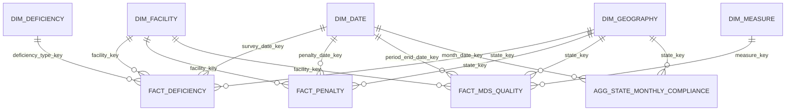

# CareWatch Gold Data Dictionary

## Purpose and model boundary

The Gold layer is a business-facing dimensional model built from the complete current state of the four Silver tables. It contains five dimensions, three event facts, one monthly aggregate, and two operational views. Gold does not reacquire CMS data, advance source watermarks, or expose raw/quarantine payloads.

All physical objects are managed Delta tables in the parameterized `<catalog>.<schema>` namespace. The implementation intentionally leaves them unpartitioned at the current project scale to avoid many small partitions. Delta does not enforce primary and foreign keys here, so `carewatch.gold` validates them before a refresh is logged as successful.

## Entity relationship diagram

Relationships are one-to-many and single direction from dimension to fact in Power BI. Facts must not be related directly to one another. `dim_facility.current_state_code` is a descriptive current-state attribute, not another physical relationship to `dim_geography`.

## Table grains and keys

| Object | Grain | Primary key | Foreign keys | Source/refresh strategy |
|---|---|---|---|---|
| `dim_facility` | One row per distinct CCN seen in any Silver table | `facility_key` | None | Current Silver provider attributes plus placeholder rows for event-only CCNs; hash-aware MERGE |
| `dim_date` | One calendar day from the earliest event month to latest event date | `date_key` | None | Regenerated date range; hash-aware MERGE |
| `dim_geography` | One observed state code plus one unknown member | `state_key` | None | Distinct Silver states plus `__UNKNOWN__`; hash-aware MERGE |
| `dim_deficiency` | One deficiency prefix/tag/category combination | `deficiency_type_key` | None | Distinct Silver deficiency types; hash-aware MERGE |
| `dim_measure` | One measure code/resident type combination | `measure_key` | None | Latest unambiguous description from Silver; hash-aware MERGE |
| `fact_deficiency` | One Silver deficiency/citation | `deficiency_key` | facility, survey date, geography, deficiency type | One row per Silver row, including soft-deleted rows; hash-aware MERGE |
| `fact_penalty` | One Silver penalty event | `penalty_key` | facility, penalty date, geography | One row per Silver row, including soft-deleted rows; hash-aware MERGE |
| `fact_mds_quality` | One CCN/measure/resident type/measure period | `mds_key` | facility, period-end date, geography, measure | One row per Silver row, including soft-deleted rows; hash-aware MERGE |
| `agg_state_monthly_compliance` | One state/month having a citation or penalty | (`state_key`, `month_date_key`) | geography, date | Complete recomputation from active facts; MERGE plus removal of stale groups |

## Column contracts

`PK` and `FK` below describe analytical constraints validated in code. `No` in Nullable means the pipeline rejects the refresh if the value is missing.

### `dim_facility`

| Column | Delta type | Nullable | Meaning |
|---|---|---:|---|
| `facility_key` | STRING | No | PK; same ordered-JSON SHA-256 of CCN used by Silver |
| `cms_certification_number_ccn` | STRING | No | CMS facility identifier |
| `provider_name` | STRING | Yes | Current provider name |
| `ownership_type` | STRING | Yes | Current ownership classification |
| `chain_id`, `chain_name` | STRING | Yes | Current chain attributes |
| `citytown`, `current_state_code`, `zip_code` | STRING | Yes | Current facility geography attributes |
| `overall_rating` | INT | Yes | Current CMS overall rating |
| `reported_total_nurse_staffing_hours_per_resident_per_day` | DOUBLE | Yes | Current reported staffing level |
| `total_nursing_staff_turnover` | DOUBLE | Yes | Current staff turnover measure |
| `number_of_certified_beds` | INT | Yes | Current certified capacity |
| `profile_as_of_date` | DATE | Yes | Provider source processing date |
| `is_currently_listed` | BOOLEAN | No | Provider row exists and is not soft deleted |
| `business_hash` | STRING | No | Hash of displayed business attributes |
| `load_timestamp` | TIMESTAMP | No | Changed-row insert/update time in UTC |

### `dim_date`

| Column | Delta type | Nullable | Meaning |
|---|---|---:|---|
| `date_key` | INT | No | PK in `yyyyMMdd` form |
| `calendar_date` | DATE | No | Calendar date |
| `year`, `quarter`, `month_number` | INT | No | Calendar breakdown |
| `month_start_date` | DATE | No | First calendar day of month |
| `year_month` | STRING | No | Display label in `yyyy-MM` form |
| `business_hash` | STRING | No | Attribute hash |
| `load_timestamp` | TIMESTAMP | No | Changed-row insert/update time in UTC |

### `dim_geography`

| Column | Delta type | Nullable | Meaning |
|---|---|---:|---|
| `state_key` | STRING | No | PK; state code or `__UNKNOWN__` |
| `state_code` | STRING | Yes | State code; null only on unknown member |
| `state_label` | STRING | No | Display label |
| `business_hash` | STRING | No | Attribute hash |
| `load_timestamp` | TIMESTAMP | No | Changed-row insert/update time in UTC |

### `dim_deficiency`

| Column | Delta type | Nullable | Meaning |
|---|---|---:|---|
| `deficiency_type_key` | STRING | No | PK; SHA-256 of ordered prefix/tag/category fields |
| `deficiency_prefix` | STRING | No | CMS deficiency prefix |
| `deficiency_tag_number` | STRING | No | CMS deficiency tag |
| `deficiency_category` | STRING | Yes | Category description |
| `business_hash` | STRING | No | Attribute hash |
| `load_timestamp` | TIMESTAMP | No | Changed-row insert/update time in UTC |

### `dim_measure`

| Column | Delta type | Nullable | Meaning |
|---|---|---:|---|
| `measure_key` | STRING | No | PK; SHA-256 of measure code/resident type |
| `measure_code` | STRING | No | CMS measure code |
| `resident_type` | STRING | No | Long Stay or Short Stay population |
| `measure_description` | STRING | Yes | Latest unambiguous measure description |
| `business_hash` | STRING | No | Attribute hash |
| `load_timestamp` | TIMESTAMP | No | Changed-row insert/update time in UTC |

### `fact_deficiency`

| Column | Delta type | Nullable | Meaning |
|---|---|---:|---|
| `deficiency_key` | STRING | No | PK copied from Silver |
| `facility_key` | STRING | No | FK to `dim_facility` |
| `survey_date_key` | INT | No | FK to `dim_date` |
| `state_key` | STRING | No | FK to `dim_geography`; unknown member for null state |
| `deficiency_type_key` | STRING | No | FK to `dim_deficiency` |
| `survey_date` | DATE | No | Citation event date |
| `severity_group`, `scope_severity_code`, `deficiency_corrected` | STRING | Yes | Citation classifications |
| `correction_date` | DATE | Yes | Recorded correction date |
| `citation_count` | INT | No | Constant 1 |
| `serious_citation_count` | INT | No | 1 for severity group G-I or J-L; otherwise 0 |
| `is_deleted` | BOOLEAN | No | Silver soft-delete state |
| `source_batch_id` | STRING | No | Silver lineage batch |
| `source_processing_date` | DATE | Yes | CMS processing date |
| `business_hash` | STRING | No | Hash of FKs, measures, flags, deletion state and lineage |
| `load_timestamp` | TIMESTAMP | No | Changed-row insert/update time in UTC |

### `fact_penalty`

| Column | Delta type | Nullable | Meaning |
|---|---|---:|---|
| `penalty_key` | STRING | No | PK copied from Silver |
| `facility_key` | STRING | No | FK to `dim_facility` |
| `penalty_date_key` | INT | No | FK to `dim_date` |
| `state_key` | STRING | No | FK to `dim_geography` |
| `penalty_date` | DATE | No | Penalty event date |
| `penalty_type` | STRING | No | Fine or Payment Denial |
| `fine_amount` | DECIMAL(14,2) | Yes | Fine dollars; remains null for non-fines |
| `payment_denial_length_in_days` | INT | Yes | Denial duration where applicable |
| `penalty_count` | INT | No | Constant 1 |
| `fine_count` | INT | No | 1 only when penalty type is Fine |
| `payment_denial_count` | INT | No | 1 only when penalty type is Payment Denial |
| `is_deleted` | BOOLEAN | No | Silver soft-delete state |
| `source_batch_id` | STRING | No | Silver lineage batch |
| `source_processing_date` | DATE | Yes | CMS processing date |
| `business_hash` | STRING | No | Hash of business and lineage fields |
| `load_timestamp` | TIMESTAMP | No | Changed-row insert/update time in UTC |

### `fact_mds_quality`

| Column | Delta type | Nullable | Meaning |
|---|---|---:|---|
| `mds_key` | STRING | No | PK copied from Silver |
| `facility_key` | STRING | No | FK to `dim_facility` |
| `period_end_date_key` | INT | No | FK to `dim_date` |
| `state_key` | STRING | No | FK to `dim_geography` |
| `measure_key` | STRING | No | FK to `dim_measure` |
| `measure_period` | STRING | No | Validated `YYYYQn-YYYYQn` source period |
| `period_end_date` | DATE | No | Last day of ending quarter |
| `q1_measure_score` … `q4_measure_score` | DOUBLE | Yes | Quarterly scores; nulls preserved |
| `footnote_for_q1_measure_score` … `footnote_for_q4_measure_score` | INT | Yes | Quarterly footnotes |
| `four_quarter_average_score` | DOUBLE | Yes | Source four-quarter score |
| `footnote_for_four_quarter_average_score` | INT | Yes | Source average footnote |
| `is_deleted` | BOOLEAN | No | Silver soft-delete state |
| `source_batch_id` | STRING | No | Silver lineage batch |
| `source_processing_date` | DATE | Yes | CMS processing date |
| `business_hash` | STRING | No | Hash of business and lineage fields |
| `load_timestamp` | TIMESTAMP | No | Changed-row insert/update time in UTC |

### `agg_state_monthly_compliance`

| Column | Delta type | Nullable | Meaning |
|---|---|---:|---|
| `state_key` | STRING | No | Composite PK and FK to geography |
| `month_date_key` | INT | No | Composite PK and FK to first day of month in date dimension |
| `citation_count` | BIGINT | No | Active deficiency count |
| `serious_citation_count` | BIGINT | No | Active serious deficiency count |
| `penalty_count` | BIGINT | No | Active penalty event count |
| `fine_count` | BIGINT | No | Active fine event count |
| `payment_denial_count` | BIGINT | No | Active payment denial count |
| `fine_amount_total` | DECIMAL(20,2) | No | Active fine dollar total; zero only when the grouped side is absent |
| `business_hash` | STRING | No | Hash of aggregate metrics |
| `load_timestamp` | TIMESTAMP | No | Changed-row insert/update time in UTC |

## Derived rules and business measures

- `date_key = CAST(date_format(date, 'yyyyMMdd') AS INT)`.
- Null event states map to the single `__UNKNOWN__` geography member.
- `2025Q1-2025Q4` maps to period end `2025-12-31` and date key `20251231`; malformed or backwards periods fail the refresh.
- The monthly aggregate excludes rows where `is_deleted=true`. Detailed facts retain them for lineage and idempotent correction history.
- A no-change rerun performs no Delta updates because the MERGE update condition compares `business_hash`; stable rows retain their original `load_timestamp`.
- “Serious citations per 100 currently listed facilities” is serious citations during the last 12 complete calendar months divided by distinct currently listed facilities in the selected state, multiplied by 100. The event numerator uses fact geography; the denominator applies the selected state to `dim_facility.current_state_code` explicitly in the BI measure.
- MDS measures must be filtered to a single `measure_key` before comparisons because different measures do not share a common meaning or scale.

## Operational views

`vw_gold_pipeline_runs` exposes correlation IDs, layer/dataset, UTC boundaries, derived duration, status, and row metrics. It omits parameters and full error messages.

`vw_gold_errors` exposes daily aggregated counts by dataset, layer, and rule from drift, Bronze quarantine, Silver quarantine, and failed execution attempts. It never exposes raw records, corrupt records, source paths, hashes, credentials, or full error text.

## Refresh validation

Before any write, the implementation checks exact staged columns, non-null and unique PKs, fact-to-Silver row-count equality, every FK, valid MDS periods, and aggregate-to-active-fact reconciliation. After all MERGEs, it rechecks deployed PK uniqueness, FK resolution, prohibited-column absence, and non-null load timestamps. A failure is logged and raised; Power BI should refresh only after the complete Gold task succeeds.

