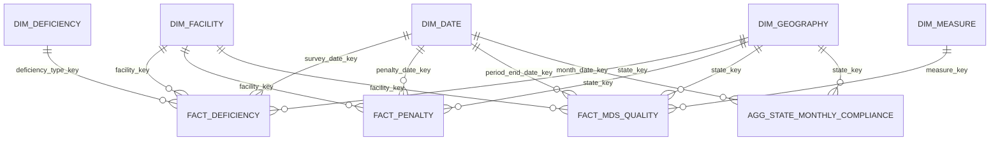

# Phase 3 Guide: Build the Gold Layer, BI Dashboard, and Final Report

This is the implementation and submission plan for **CareWatch**, the CMS nursing-home warehouse. It continues the existing Databricks Free Edition, Unity Catalog, PySpark, and Delta pipeline. The proposed Gold tables, BI report, and PDF are **work to build in Phase 3**; the repository currently proves the pipeline through Silver. Use `carewatch.pipeline` as the default namespace, while retaining the existing catalog/schema parameters.

**Build order:** lock the questions and grains → build Gold dimensions and facts → wire the refresh after Silver → validate replay and logs → connect Power BI → capture Spark and cost evidence → write and export the PDF → submit. Build and reconcile `fact_deficiency` first, then complete the other tables before designing the dashboard.

---

## 0. Instructor requirements and proof to retain

| Requirement | Work product | Evidence for submission |
| --- | --- | --- |
| Dimensional Gold, not Silver copies | `dim_*` and `fact_*` Delta tables with documented grains and keys | ER diagram/data dictionary, table DDL, row and key checks |
| Gold optimization | Measured read strategy for the larger tables | Before/after query timing or a reasoned decision to leave small tables unpartitioned |
| Automatic Silver-to-Gold refresh | Gold task after `03_bronze_to_silver.ipynb` in one workflow | Job task graph, incremental run, retry/no-duplicate proof |
| Continued audit logging | `Silver-to-Gold` attempts in `pipeline_execution_logs` | Status, input/output/aggregated rows, UTC duration, failure and retry example |
| Live BI connection and semantic model | Power BI `.pbix` (preferred by the proposal) or Tableau `.twbx`/published link | Connection settings without secrets, Model view screenshot, working interactions |
| Business and operational visuals | Questions from Phase 1 plus audit/error views | At least three different business visuals and an audit/error page |
| Final architecture and FinOps PDF | `docs/reports/CareWatch_Final_Architecture_Report.pdf` | Architecture, decision log, actual Spark DAG screenshot and interpretation, measured cost assumptions |
| Final GitHub repository | End-to-end notebooks, reusable source, docs, evidence | Publicly accessible submission link and reproducible README |

Do not count a diagram in a proposal or screenshots of planned tables as implementation evidence. Save actual output from the final Gold run and the final BI file.

---

## 1. Confirm the analytical contract before writing Gold

The authoritative starting points are [the Phase 1 proposal](data_analysis_project_proposal.md), [Phase 2 guide](phase2_guidelines.md), [`src/carewatch/schemas.py`](../src/carewatch/schemas.py), [`src/carewatch/audit.py`](../src/carewatch/audit.py), and the [README](../README.md). The four Silver sources are `silver_facility`, `silver_deficiency`, `silver_penalty`, and `silver_mds_quality`. The common business identifier is the string `cms_certification_number_ccn` (CCN). Do not convert it to a number or strip leading zeroes.

Before implementation, write a short metric contract in `docs/gold_data_dictionary.md` for each Phase 1 question:

| Phase 1 question | Defensible Gold measure and filter | Important qualification |
| --- | --- | --- |
| Which facilities have serious or repeated deficiencies? | Count distinct `deficiency_key` in the **last 12 complete calendar months** by `survey_date`; serious means `severity_group IN ('G-I','J-L')`; repeated means serious citations on at least two distinct survey dates in that window. | A citation is not a facility or survey. Show all three counts separately. This is a screening signal, not a clinical safety verdict. |
| Which states, ownership types, or chains have weaker outcomes? | Serious citations per 100 **currently listed** facilities in the same state/owner group, penalty dollars, and current average overall rating. Use the last 12 complete calendar months for event numerators. | State comes from the event record. Ownership and chain are the **current** provider attributes, so older events are attributed to today's owner/chain. Label this explicitly. |
| How do staffing and turnover relate to quality? | Two rating-group column charts: average **current** `reported_total_nurse_staffing_hours_per_resident_per_day` and average **current** `total_nursing_staff_turnover`, each grouped by **current** `overall_rating` (1–5). Show the non-null facility count in each chart's tooltip. | These are unweighted averages of current facility profiles. Association is not causation. A historical staffing/rating trend requires saved provider snapshots; Silver SCD1 does not retain old ratings. |
| Which facilities have the largest fines/denials? | Sum `fine_amount` for `penalty_type='Fine'`; separately count `Payment Denial` events and report denial days. | A payment denial has no fine amount; do not turn null `fine_amount` into zero and describe it as a fine. |
| How do events and quality measures change over time? | Survey-date citation and penalty-date fine series supply the validated event trends. For MDS, compare the four-quarter average of **one named measure** across current rating groups; show its measure period and contributing facility count. Build an MDS period-end trend only after at least two distinct period-end dates exist for the same `measure_key`. | The current Gold load has one MDS period per measure, so a period-end line would contain one point. Do not present it as a trend. MDS measures have different meanings and directions; do not average unrelated measures or replace null scores with zero. |

Specify date range, numerator, denominator, null treatment, distinct-count key, and refresh date for every KPI. Validate CMS measure meanings/footnotes before assigning “higher is better” or combining MDS scores.

---

## 2. Step 1 — lock the Gold dimensional model

### 2.1 Decisions for this project

Build **five dimensions, three detailed facts, and one monthly aggregate** in `carewatch.pipeline`, plus two sanitized operational views. Each detailed fact forms a star around shared facility, date, and state dimensions. This is the final Phase 3 scope; use these names and grains in the data dictionary, Power BI model, and report.

1. `silver_facility` remains **SCD Type 1**. `dim_facility` shows the latest accepted provider attributes. Historical citations and penalties have their own event dates, but ownership, staffing, and ratings shown beside those old events are today's known attributes. Label them “current.” Do **not** build `fact_facility_snapshot` or a staffing/rating history chart: Silver has not retained an independently validated provider history. Record this deliberate change from the Phase 1 proposal in the PDF decision log.
2. Carry all Silver fact rows, including `is_deleted=true`, into Gold and keep the same entity PKs. Gold reports filter `is_deleted=false`. This preserves event lineage and lets a later Silver soft delete update one fact row. A row physically absent from a complete current Silver table is removed from its Gold fact during refresh.
3. Use `facility_key` already defined by `silver_facility`; resolve fact FKs by joining on **string CCN**. Build one placeholder `dim_facility` row for each CCN found only in a Silver fact, with `is_currently_listed=false` and unknown descriptive fields. This preserves referential coverage without pretending the missing facility has a current rating or owner.
4. Use integer `YYYYMMDD` date keys. The event's `survey_date` or `penalty_date` determines its date FK. The MDS reporting date is the **last day of the ending quarter** in the validated `measure_period` string (`YYYYQn-YYYYQn`); retain the original period label as well. A malformed or backwards quarter range fails Gold validation.
5. Use a state-level `dim_geography`. The event's own `state` supplies the fact FK; null state maps to the explicit `__UNKNOWN__` member. Do not infer county from ZIP or join `dim_geography` to `dim_facility` in Power BI; those two routes would create ambiguous filters.
6. Every Gold table is a managed Delta table, initially **unpartitioned**. Use full-source, hash-aware Delta `MERGE` for dimensions/facts. Build `agg_state_monthly_compliance` by separately grouping the two event facts, then joining those grouped results. Never join detailed facts before aggregation.

### 2.2 Table-by-table grain, keys, and columns

The columns below are the **Gold contract**. Add only lineage/technical columns that serve a defined validation or audit purpose; Gold is a selected analytical model, not a copy of Silver. Every physical table also has non-null `load_timestamp` and a Gold `business_hash` of its business columns, excluding load time and source file paths. Retain `source_batch_id` and `source_processing_date` on detailed facts for traceability; do not publish raw paths or address hashes.

| Table | One row means; PK | Required business columns and FKs | Source and update rule |
| --- | --- | --- | --- |
| `dim_facility` | One CCN; `facility_key STRING` | `cms_certification_number_ccn STRING` unique, `provider_name`, `ownership_type`, `chain_id`, `chain_name`, `citytown`, `current_state_code`, `zip_code`, `overall_rating INT`, `reported_total_nurse_staffing_hours_per_resident_per_day DOUBLE`, `total_nursing_staff_turnover DOUBLE`, `number_of_certified_beds INT`, `profile_as_of_date DATE`, `is_currently_listed BOOLEAN` | Current `silver_facility` profile plus per-CCN placeholders from the three Silver fact sources. `profile_as_of_date=source_processing_date`; a missing provider row has null metrics and `false`. Merge by `facility_key`; remove CCNs absent from all Silver tables. |
| `dim_date` | One calendar day; `date_key INT` | `calendar_date DATE` unique, `year INT`, `quarter INT`, `month_number INT`, `month_start_date DATE`, `year_month STRING` | Generate every day from the **first day of the earliest event month** through the latest survey date, penalty date, or MDS period-end date. This includes the aggregate's month-start FK. With no event dates, stage an empty dimension. Merge missing dates; no deletions. |
| `dim_geography` | One source state code; `state_key STRING` | `state_code STRING` (same value for known states), `state_label STRING` | Distinct non-null state codes from the four Silver datasets plus `__UNKNOWN__` with label `Unknown state`. Merge; no county/ZIP rollup. |
| `dim_deficiency` | One `(deficiency_prefix, deficiency_tag_number, deficiency_category)` combination; `deficiency_type_key STRING` | The three source fields; category stays nullable | Distinct combinations from `silver_deficiency`; SHA-256 key from ordered, null-preserving values. Omit changing free-text description from this dimension. Merge; no deletions. |
| `dim_measure` | One `(measure_code, resident_type)` combination; `measure_key STRING` | `measure_code`, `resident_type`, `measure_description` | Distinct pairs from `silver_mds_quality`; SHA-256 key from ordered values. Use the description from the row with latest `source_processing_date`, then latest `load_timestamp`. Conflicting descriptions tied at that latest timestamp fail validation rather than picking an arbitrary value. Merge. |
| `fact_deficiency` | One Silver citation; `deficiency_key STRING` | `facility_key`, `survey_date_key`, `state_key`, `deficiency_type_key`; `survey_date DATE`, `severity_group`, `scope_severity_code`, `deficiency_corrected`, `correction_date`, `citation_count INT=1`, `serious_citation_count INT` (1 for G-I/J-L, else 0), `is_deleted` | One row per `silver_deficiency.deficiency_key`, including soft-deleted rows. Merge by `deficiency_key`; all four FKs must resolve. |
| `fact_penalty` | One Silver penalty event; `penalty_key STRING` | `facility_key`, `penalty_date_key`, `state_key`; `penalty_date DATE`, `penalty_type`, `fine_amount DECIMAL(14,2)` nullable, `payment_denial_length_in_days INT` nullable, `penalty_count INT=1`, `fine_count INT`, `payment_denial_count INT`, `is_deleted` | One row per `silver_penalty.penalty_key`. A payment denial retains null fine amount; the two count flags follow `penalty_type`. Merge by `penalty_key`. |
| `fact_mds_quality` | One Silver CCN + measure + resident type + measure period; `mds_key STRING` | `facility_key`, `period_end_date_key`, `state_key`, `measure_key`; original `measure_period`, `period_end_date DATE`, `q1`–`q4_measure_score`, `four_quarter_average_score`, the corresponding footnotes, `is_deleted` | One row per `silver_mds_quality.mds_key`. Keep scores nullable and never average across different measure keys without documented comparability. Merge by `mds_key`. |
| `agg_state_monthly_compliance` | One state + calendar month with at least one citation or penalty; PK `(state_key, month_date_key)` | FKs to `dim_geography` and `dim_date` (first day of month); five `BIGINT` columns: `citation_count`, `serious_citation_count`, `penalty_count`, `fine_count`, `payment_denial_count`; `fine_amount_total DECIMAL(20,2)` | Group **active** deficiency and penalty facts separately by event state/month. Full-outer join the two grouped sets; absent count or amount on one side becomes zero **only in this aggregate**. Merge changed groups and delete groups absent from the complete recomputed source. |

Declare every PK and FK, each count/flag, `business_hash`, and `load_timestamp` non-null. Preserve Silver's nullable descriptive fields, penalty amount/days, MDS scores, and footnotes as nullable. The unknown geography row has `state_key='__UNKNOWN__'`, `state_code=NULL`, and `state_label='Unknown state'`. The dimensions' `business_hash` includes their displayed attributes; the detailed facts' hash includes FKs, measures, flags, and `is_deleted`. The aggregate hash includes its counts and fine total. A stable hash means a rerun leaves `load_timestamp` unchanged for an identical row. Keep technical keys and hashes hidden in the BI report.

### 2.3 Relationship diagram and meaning



All arrows represent one dimension row to many fact/aggregate rows. `dim_facility.current_state_code` is an attribute, **not** a second link to `dim_geography`. Do not relate the three facts directly to one another. The monthly aggregate serves state/month trends; the detailed facts serve drill-through and facility analysis. A Power BI measure must choose one of those sources rather than summing the same events from both.

The state rate is **serious citations in the last 12 complete calendar months / distinct currently listed facilities in that state × 100**. Anchor the window to the UTC date of the last successful Gold refresh: from the first day of the month 12 months before that date, inclusive, to the first day of its month, exclusive. The numerator uses event state; the denominator uses `dim_facility.current_state_code` and `is_currently_listed=true`. In Power BI, the geography slicer filters event facts normally; the denominator measure must apply the selected state codes to `dim_facility.current_state_code` explicitly (for example, DAX `TREATAS`) because there is deliberately no ambiguous geography-to-facility relationship. Ownership and chain comparisons use today's `dim_facility` attributes for both fact filtering and the current facility denominator. A facility with no current provider profile does not enter these denominators. In titles/tooltips call the measure “serious citations per 100 currently listed facilities,” and include the exact event window. Compare current staffing and turnover across current rating groups, with facility counts visible. Do not infer historical ratings or causal effects.

Create `docs/gold_data_dictionary.md` from this contract, with actual Delta types/nullability, PK/FK checks, source-to-target mapping, metric formulas, and the final diagram. Delta does not enforce the analytical PK/FK semantics here; the pipeline checks them before calling a refresh successful.

Keep operational reporting separate from the business stars. Create `vw_gold_pipeline_runs` from `pipeline_execution_logs` with run IDs, layer, dataset, UTC start/end, calculated duration seconds, status, and row metrics; omit `parameter_processed` and `error_message`. Create `vw_gold_errors` as daily counts by dataset, source layer, and rule from `schema_drift_log` and the exploded `failed_rules` arrays in both quarantine tables, plus counts of failed execution attempts. Exclude raw records, source paths, and full error text. These are two **views**, so the fixed physical table count remains nine.

---

## 3. Step 2 — implement and prove the Gold transformations

### 3.1 Files, setup, and inputs

Create these exact additions:

```text
src/carewatch/gold.py                 pure key/date/metric helpers, Spark transforms, MERGE and checks
notebooks/04_silver_to_gold.ipynb     widgets and one audited refresh orchestration
docs/gold_data_dictionary.md         deployed Gold columns, grains, relationships, measures
docs/evidence/phase3/                Gold outputs, job/DAG and BI screenshots
docs/reports/                        final architecture PDF
bi/CareWatch.pbix                    final Power BI file
```

Extend `00_setup_tables.ipynb` to create or verify the nine Gold tables in the same parameterized catalog/schema. Keep the DDL/`StructType` definitions beside the transformations in `gold.py`; fail on incompatible existing schemas instead of silently replacing a populated table. `04_silver_to_gold.ipynb` accepts `catalog`, `schema`, `load_type`, and `pipeline_run_id`. Every execution reads **the entire current Silver state** from all four tables, including after a Silver backfill. That makes a late correction, a Silver soft delete, and a retry converge to the same Gold result. The notebook must never reacquire CMS data or advance `ingestion_watermarks`.

### 3.2 Implement in this fixed dependency order

1. **Stage Silver inputs.** Read all four tables once for the refresh. Assert Silver entity keys and CCNs are non-null and unique at their documented grains. Keep deleted rows for detailed facts and facility reference coverage. Normalize only Gold-specific derived fields; do not redo Silver casting or privacy work.
2. **Build `dim_facility`.** Take the current Silver provider rows and union the distinct CCNs from deficiencies, penalties, and MDS. Reuse the **same ordered-JSON SHA-256 facility-key function** used by Silver for CCN; do not hash a different serialization. Left join provider attributes by CCN, create one placeholder per missing CCN, and set `is_currently_listed = provider row exists AND provider.is_deleted=false`. For a deleted provider profile, keep its known identity but mark it unlisted. Check one row per CCN and one key per CCN.
3. **Build `dim_date` and `dim_geography`.** Parse MDS `measure_period` using its Silver contract `^[0-9]{4}Q[1-4]-[0-9]{4}Q[1-4]$`; validate start quarter ≤ end quarter and derive the end quarter's calendar last day. Construct `date_key` as `year*10000 + month*100 + day`. Generate every calendar day from the first day of the earliest event month through the latest event/period-end date, so each aggregate month key exists; derive month/year fields. Collect distinct valid state codes from Silver and add `__UNKNOWN__`; null event states use that key. Do not turn null state into a real US state.
4. **Build `dim_deficiency` and `dim_measure`.** Use the key combinations in Step 1, with an explicit null sentinel and field order in the SHA-256 serialization. For `dim_measure`, rank candidate descriptions by processing date and load time, resolve the latest, and fail an unresolved latest-timestamp conflict. Assert no duplicate type/measure keys.
5. **Build the three facts.** Project only the Step 1 columns from the corresponding Silver table; derive FKs and count flags. Join facility on CCN, date on the actual event or period-end date, and the two type dimensions on their defined keys. Use left joins while validating so missing FKs are counted; fail the refresh if any remain, instead of losing a source row in an inner join. Copy `is_deleted`, `source_batch_id`, and `source_processing_date`. Keep penalty amounts and missing MDS scores nullable.
6. **Build `agg_state_monthly_compliance` last.** Filter each event fact to `is_deleted=false`. Group deficiencies and penalties **separately** by `state_key` and first day of their event month. Full-outer join the two small grouped frames on state/month and fill only absent aggregate outputs with zero. This group-by/join is the transformation to capture for the Spark UI DAG in the PDF.
7. **Prepare the operational views.** Code `vw_gold_pipeline_runs` and `vw_gold_errors` exactly as Step 1 specifies; deploy them after the audit-table migration in Step 3, so `rows_aggregated` already exists. An operational row represents an execution attempt or an aggregated error count, never a business citation or penalty. Check that neither view exposes `raw_record`, `corrupt_record`, paths, or full error text.

Use these exact derived-value rules in `gold.py`:

```text
serious_citation_count = 1 when severity_group is G-I or J-L; otherwise 0
fine_count             = 1 when penalty_type is Fine; otherwise 0
payment_denial_count   = 1 when penalty_type is Payment Denial; otherwise 0
state_key              = state when state is non-null; otherwise __UNKNOWN__
date_key(DATE)         = CAST(date_format(DATE, 'yyyyMMdd') AS INT)
MDS end month          = 3 × the quarter number after the hyphen in measure_period
MDS period_end_date    = last_day(make_date(end_year, MDS end month, 1))
```

For example, `2025Q1-2025Q4` maps to `2025-12-31`, and its `period_end_date_key` is `20251231`. Reject a period whose starting year/quarter is later than its ending year/quarter. The monthly aggregate uses **only** `fact_deficiency` and `fact_penalty`; MDS scores have different definitions and must stay in their own fact.

The aggregate construction must follow this shape:

```sql
WITH deficiency_month AS (
  SELECT state_key, CAST(date_trunc('MONTH', survey_date) AS DATE) AS month_start,
         SUM(citation_count) AS citation_count,
         SUM(serious_citation_count) AS serious_citation_count
  FROM staged_fact_deficiency WHERE is_deleted = false
  GROUP BY state_key, CAST(date_trunc('MONTH', survey_date) AS DATE)
), penalty_month AS (
  SELECT state_key, CAST(date_trunc('MONTH', penalty_date) AS DATE) AS month_start,
         SUM(penalty_count) AS penalty_count, SUM(fine_count) AS fine_count,
         SUM(payment_denial_count) AS payment_denial_count,
         SUM(fine_amount) AS fine_amount_total
  FROM staged_fact_penalty WHERE is_deleted = false
  GROUP BY state_key, CAST(date_trunc('MONTH', penalty_date) AS DATE)
)
SELECT COALESCE(d.state_key, p.state_key) AS state_key,
       CAST(date_format(COALESCE(d.month_start, p.month_start), 'yyyyMMdd') AS INT)
         AS month_date_key,
       COALESCE(d.citation_count, 0) AS citation_count,
       COALESCE(d.serious_citation_count, 0) AS serious_citation_count,
       COALESCE(p.penalty_count, 0) AS penalty_count,
       COALESCE(p.fine_count, 0) AS fine_count,
       COALESCE(p.payment_denial_count, 0) AS payment_denial_count,
       CAST(COALESCE(p.fine_amount_total, 0) AS DECIMAL(20,2)) AS fine_amount_total
FROM deficiency_month d
FULL OUTER JOIN penalty_month p
  ON d.state_key = p.state_key AND d.month_start = p.month_start;
```

All nine staged outputs must pass checks before writes begin. Then merge dimensions, detailed facts, and finally the aggregate in that order. `load_timestamp` is set when a target row is inserted or meaningfully updated. The fact/aggregate `business_hash` is computed after all derived FKs and metrics are present. A no-change MERGE performs zero target updates. Remove missing-source rows from `dim_facility`, the three detailed facts, and the monthly aggregate because they represent the **complete current Silver state**; keep unused date/type/geography dimension members. A partial month/batch input must never drive removal. Recheck those five deployed key sets against their complete staged outputs before success.

Use Delta `MERGE` with this behavior (pseudo-SQL; generate the real per-table column lists from the locked contracts):

```sql
MERGE INTO carewatch.pipeline.fact_deficiency AS target
USING staged_fact_deficiency AS source
ON target.deficiency_key = source.deficiency_key
WHEN MATCHED AND target.business_hash <> source.business_hash THEN UPDATE SET ...
WHEN NOT MATCHED THEN INSERT (...);
```

Dimension and other detailed fact merges follow the same pattern with their PK. Compute inserted/updated counts from Delta operation metrics or a pre/post key comparison and reconcile them to audit rows. A crash after some table merges cannot create duplicate keys on retry; do not mark Gold complete or refresh BI until **all nine** targets and checks succeed.

### 3.3 Required validation and saved evidence

Use reusable assertions in `gold.py`, not manual spot checks. Record expected and actual numbers for each refresh:

```sql
-- Exactly one Gold row for every current Silver citation, including soft-deleted ones.
SELECT (SELECT COUNT(*) FROM carewatch.pipeline.silver_deficiency) AS silver_rows,
       (SELECT COUNT(*) FROM carewatch.pipeline.fact_deficiency) AS gold_rows;

SELECT COUNT(*) AS duplicate_keys
FROM (SELECT deficiency_key FROM carewatch.pipeline.fact_deficiency
      GROUP BY deficiency_key HAVING COUNT(*) > 1);

SELECT COUNT(*) AS missing_facility_fk
FROM carewatch.pipeline.fact_deficiency f
LEFT ANTI JOIN carewatch.pipeline.dim_facility d
  ON f.facility_key = d.facility_key;

SELECT SUM(serious_citation_count) AS serious_from_fact
FROM carewatch.pipeline.fact_deficiency WHERE is_deleted = false;

SELECT SUM(serious_citation_count) AS serious_from_aggregate
FROM carewatch.pipeline.agg_state_monthly_compliance;
```

Repeat count, PK uniqueness, and all-FK anti-join checks for penalties and MDS. Check unique CCNs in `dim_facility`, unique dates/states/type/measure keys, unique `(state_key, month_date_key)` aggregate groups, and non-null `load_timestamp` on all nine tables. The active fact sum must equal the monthly aggregate sum; reconcile fine dollars and denial counts too. Verify no `telephone_number`, `provider_address`, `location`, `provider_address_hash`, `raw_record`, or secret value reaches Gold. Save both a first refresh and an unchanged rerun: the second has identical counts, zero MERGE inserts/updates, and unchanged timestamps for stable keys. Run one late Silver correction and one soft-delete fixture, then prove only affected Gold rows/aggregate groups change.

### 3.4 Physical layout decision

Leave all nine managed Delta tables unpartitioned in this implementation. This matches the Phase 2 small-file decision and avoids tiny partitions at the project's current size. Save a representative state/month BI query's runtime and scan metrics. Run `OPTIMIZE carewatch.pipeline.fact_deficiency` **once** as the rubric's optional optimization demonstration, rerun the same query, and record both measurements and the maintenance time. Do not enable liquid clustering for Phase 3; include the measured result and this layout decision in the PDF. Current Databricks guidance favors liquid clustering over static partitioning for larger filtered tables ([partition guidance](https://docs.databricks.com/aws/en/tables/partitions), [liquid clustering](https://docs.databricks.com/aws/en/delta/clustering)).

---

## 4. Step 3 — attach Gold to the existing pipeline and audit trail

This step turns the four notebooks into **one dependent Databricks Job** and extends the existing audit record. The scheduled job must be the route by which a new CMS incremental reaches Gold; running `04_silver_to_gold.ipynb` by hand is reserved for repair/evidence, not routine operation. The existing source watermark still belongs to Raw-to-Bronze. Gold reads current Silver state and never moves that watermark.

### 4.1 Migrate the existing audit table before deploying new writers

The current `pipeline_execution_logs` schema in `src/carewatch/audit.py` has three valid layers and no Gold aggregation metric. `ensure_control_tables` verifies exact names and types, so a code-only schema edit would make `02_raw_to_bronze.ipynb` fail when it calls setup. Apply this migration in a controlled deployment, preserving every Phase 2 log row:

1. Record `SELECT COUNT(*) FROM carewatch.pipeline.pipeline_execution_logs` and `DESCRIBE TABLE carewatch.pipeline.pipeline_execution_logs`. Both columns are absent from the current Phase 2 contract, so run the following DDL once. If a partially applied migration has already added one, issue `ADD COLUMNS` for the missing column alone:

   ```sql
   ALTER TABLE carewatch.pipeline.pipeline_execution_logs
   ADD COLUMNS (pipeline_run_id STRING, rows_aggregated BIGINT);
   ```

2. Append nullable `pipeline_run_id STRING` and `rows_aggregated BIGINT` fields to `LOG_SCHEMA`. Update `completed_log_record`, `audited`, and their validation to accept a pipeline ID and a nonnegative aggregation count. New acquisition/Bronze/Silver attempts set `rows_aggregated=0`; existing rows remain null in both new columns because their values were never measured. Add `Silver-to-Gold` to `VALID_LAYERS`; keep `VALID_LOAD_TYPES` as `full`/`incremental`.
3. Add a `pipeline_run_id` widget to **each** of `01_acquire_cms.ipynb`, `02_raw_to_bronze.ipynb`, and `03_bronze_to_silver.ipynb`, then pass its value into every audit write. In `01`, update both ordinary acquisition logs and the `SKIPPED_ALREADY_ACQUIRED` path, which calls `completed_log_record` directly. In `02` and `03`, pass it into `audited`. The new `04` notebook uses the same helper. Preserve the existing `run_id` generation in each layer; add the Job ID as a separate correlation field.
4. Rerun `00_setup_tables.ipynb` after the physical and code changes. It must report the log table verified, with the original row count unchanged. Query old rows to confirm the new fields are null, and make one harmless new attempt to confirm they are populated. Do **not** drop/recreate the audit table or write a made-up aggregation count into historical logs.

For a Job execution, `pipeline_run_id` identifies the **whole Job run**. `run_id` retains its current layer-specific meaning, and `batch_id` identifies a source batch when one exists. A new `Bronze-to-Silver` row can therefore be joined to the Gold audit row by `pipeline_run_id`, while source-to-Gold row lineage remains in each fact's `source_batch_id`. For a notebook run outside a Job, leave the nullable `pipeline_run_id` empty; do not invent a Databricks Job ID.

### 4.2 Define the daily Job exactly

Create a Job named **CareWatch Daily Incremental**, using the committed notebooks from a recorded Git revision of this repository. Schedule it **daily at 03:00 UTC** with the Job timezone set to UTC, set maximum concurrent Job runs to **1**, and make each downstream task run only when its parent succeeded. Configure job parameters `catalog=carewatch`, `schema=pipeline`, and `load_type=incremental`. In each notebook task, pass `catalog={{job.parameters.catalog}}`, `schema={{job.parameters.schema}}`, `load_type={{job.parameters.load_type}}`, and `pipeline_run_id={{job.run_id}}`. Databricks documents these [dynamic values](https://docs.databricks.com/aws/en/jobs/dynamic-value-references), [Job parameters](https://docs.databricks.com/aws/en/jobs/job-parameters), [task dependencies](https://docs.databricks.com/aws/en/jobs/run-if), and [Job configuration](https://docs.databricks.com/aws/en/jobs/configure-job). The current [Free Edition limits](https://docs.databricks.com/aws/en/getting-started/free-edition-limitations) include Jobs with a concurrency cap; this serial four-task Job stays below it.

| Order / task name | Notebook and parent | Fixed task widget values in addition to shared parameters | Success condition |
| --- | --- | --- | --- |
| 1. `acquire_cms` | `01_acquire_cms.ipynb`; no parent | `overlap_days=60`, `force_refresh=false`, `landing_root=/Volumes/carewatch/pipeline/landing` | All four dataset acquisitions finish without an exception. An unchanged publication may log `SKIPPED_ALREADY_ACQUIRED`. |
| 2. `raw_to_bronze` | `02_raw_to_bronze.ipynb`; depends on `acquire_cms` | `dataset=all`, blank `acquisition_run_id` and `source_path`, `reprocess=false` | All selected files/pages and their acquisition-run reconciliations complete. |
| 3. `bronze_to_silver` | `03_bronze_to_silver.ipynb`; depends on `raw_to_bronze` | `dataset=all`, blank `acquisition_run_id`, `batch_ids`, `ingest_from`, and `ingest_to`; `reprocess=false`, `allow_soft_deletes=false`; set `address_secret_scope`/`address_secret_key` to **secret names**, not the salt | Every selected batch finishes without a `FAILURE`; accepted rows from a `QUARANTINED_PARTIAL` Silver batch still proceed to Gold. |
| 4. `silver_to_gold` | `04_silver_to_gold.ipynb`; depends on `bronze_to_silver` | No backfill filter; read all four Silver tables | All nine Gold merges and validation checks finish, then one Gold `SUCCESS` log is written. |

Run `00_setup_tables.ipynb` once during deployment, outside this daily schedule, to verify the namespace, audit migration, and Gold tables. For the **first full bootstrap**, run the same four-task Job manually with its `load_type` Job parameter overridden to `full`; after that, let the default daily incremental schedule run. The existing acquisition notebook requires a completed Bronze watermark before an ordinary API incremental, so the full bootstrap must reach Bronze first.

### 4.3 Enforce failure gates at every boundary

The deployed `01_acquire_cms.ipynb` raises when any acquisition fails, `02_raw_to_bronze.ipynb` raises after displaying evidence when `file_failures` or `partial_runs` is nonempty, and `03_bronze_to_silver.ipynb` raises after recording failed batches. Already committed successful files and their audit records remain available; a retry selects only pending work. The dependent daily Job is active with these failure gates.

The resulting release gates are:

```text
Acquisition FAILURE       → stop before Bronze
Bronze file failure or incomplete acquisition reconciliation → stop before Silver
Silver batch FAILURE      → stop before Gold
Silver QUARANTINED_PARTIAL with accepted rows, no failures → run Gold
Gold build/MERGE/check or audit-write FAILURE → Job fails; do not refresh BI Import
Gold SUCCESS              → BI file may refresh from the validated Gold model
```

`04` must enter one `audited` context before staging/counting Silver data. It reads all four current Silver tables and executes the **nine hash-aware merges** from Step 2 on each successful upstream run, even when that run found no new source rows. There is **no Gold batch checkpoint**: the deterministic full-source MERGEs make retries safe and log zero changed rows on an unchanged state. A failure after some target tables commit is possible because the nine Delta merges are not one cross-table transaction. Retry `04` from Silver, re-run all checks, and keep Power BI Import on its previous successful refresh until the whole Gold task succeeds. Do not claim an atomic nine-table publish.

For a registered historical replay, create a separate **CareWatch Backfill** Job with `02_raw_to_bronze.ipynb` → `03_bronze_to_silver.ipynb` → `04_silver_to_gold.ipynb`, the same dependency gates and dynamic `pipeline_run_id`, and **no schedule**. Pass the exact Phase 2 `dataset` and `acquisition_run_id` to `02`; pass `dataset`, `acquisition_run_id`, and the intended comma-separated `batch_ids` to `03`. Set `reprocess=true` on `02` and `03`, and leave `allow_soft_deletes=false`. Pause the daily Job schedule while this Backfill Job runs, then resume it after Gold succeeds, so the two Jobs never write the same Silver/Gold tables concurrently. `04` still reads all current Silver state; the backfill never needs a separate Gold script or another CMS download. Record the requested batch IDs and resulting changes in its Gold audit summary.

### 4.4 Define one Gold audit attempt per refresh

Wrap the entire `04` refresh in one `audited` call with `pipeline_layer='Silver-to-Gold'`, `dataset='all'`, `load_type` from the Job parameter, `batch_id='gold:' + pipeline_run_id`, and a fresh UUID `run_id`. Put a compact structured summary in `parameter_processed`: target names, `pipeline_run_id`, and **only the Silver batch IDs processed by task 3 in this Job run** (not every historic batch in the full Silver scan). Derive that list from this Job's `Bronze-to-Silver` execution logs with `status IN ('SUCCESS','QUARANTINED_PARTIAL')`. Count/record:

| Log field | Gold meaning |
| --- | --- |
| `rows_read` | Sum of the four Silver table row counts used for the refresh, including soft-deleted rows; each logical input row counted once. |
| `rows_aggregated` | Active deficiency rows plus active penalty rows contributing to the two monthly `GROUP BY` operations. It is an **input-row** count, not the number of output state/month groups. |
| `rows_inserted`, `rows_updated`, `rows_deleted` | Sums of actual Delta operation metrics across the nine targets. Deletion means a Gold facility, detailed fact, or monthly group is absent from the complete current Silver-derived output. A Silver soft delete remains a Gold fact row with `is_deleted=true`. |
| `rows_quarantined` | `0`. Gold does not invent a third quarantine policy: invalid Gold keys/periods/FKs fail the task with an actionable error. |
| `start_time`, `end_time`, `load_timestamp` | UTC attempt boundaries and log write time; derive duration as `end_time - start_time` in the operational view. |
| `status`, `error_message` | `SUCCESS` only after the final reconciliation; otherwise `FAILURE` with the existing truncated error policy. |

Accumulate row metrics **after each target merge**, so a failure log reports any target writes that already committed. If the data work succeeds but appending the audit row fails, fail the Job; a later idempotent retry can write the missing success record. Do not record a Gold `SUCCESS` before all checks or treat the acquisition watermark as a Gold completion marker.

### 4.5 Run and save the acceptance evidence

1. **Full bootstrap:** override `load_type=full`, run the complete Job, save its four-task dependency graph and one successful `Silver-to-Gold` log. Check Step 2's PK/FK/count reconciliations. This is the baseline.
2. **Real incremental:** run the default Job when an acquired file/page contains a new or changed Silver row. Save the Job run ID, acquired manifest `batch_id`, matching Silver log, Gold log with the same `pipeline_run_id`, Gold Delta metrics, and before/after counts. A screenshot of `04` run manually is insufficient for this requirement.
3. **No-change replay:** rerun the same registered input in an isolated demo scope or repeat a Job run while source content is unchanged. Show unchanged Gold PK counts and `load_timestamp` for sampled keys, plus Gold `rows_inserted=rows_updated=rows_deleted=0`.
4. **Failure and repair:** in `carewatch.phase3_demo`, inject a controlled failure after one Gold target merge. Save the Gold `FAILURE` log and failed Job status. Repair/rerun the Gold task against the same Silver state; prove it completes without duplicate keys and writes a `SUCCESS` log. Keep the fixture out of production.
5. **Bronze gate:** in the demo scope, process an incomplete acquisition run and show that `raw_to_bronze` now fails and neither Silver nor Gold starts. Successful independent Bronze files remain available for retry.

Save the run graph, scoped query output, and screenshots under `docs/evidence/phase3/`. This query is the main audit proof (replace the placeholder with the actual Job-run ID):

```sql
SELECT pipeline_run_id, pipeline_layer, dataset, batch_id, status,
       start_time, end_time,
       timestampdiff(SECOND, start_time, end_time) AS duration_seconds,
       rows_read, rows_aggregated, rows_inserted, rows_updated, rows_deleted,
       rows_quarantined, error_message
FROM carewatch.pipeline.pipeline_execution_logs
WHERE pipeline_run_id = '<job-run-id>'
ORDER BY start_time, pipeline_layer, dataset;
```

Add the daily/full/backfill Job parameters, failure behavior, audit query, and BI refresh gate to the README. The Phase 2 saved output proves the earlier layers; these **new Phase 3 runs** prove automatic Silver-to-Gold integration.

---

## 5. Step 4 — connect Power BI and build the semantic model

The proposal chose Power BI. **Test the live connection early:** confirm that your workspace exposes a SQL warehouse, copy its **Server Hostname** and **HTTP Path**, and verify which Power BI connector and sign-in method actually work for the workspace. The Microsoft **Databricks** connector is specified for AWS SQL warehouses with OAuth; Microsoft's connector page directs Azure Databricks and other authentication cases to the **Azure Databricks** connector. In Power BI Desktop, select only Gold business/monitoring tables or approved views. Start with **Import** for this small dataset; refresh it after successful Gold runs. DirectQuery is an option if live querying is necessary and the warehouse is available, but measure latency and compute cost. The current [Databricks Power BI connection guide](https://docs.databricks.com/aws/en/partners/bi/power-bi/desktop) and [Microsoft connector guide](https://learn.microsoft.com/en-us/power-query/connectors/databricks) document the fields, authentication, and Import/DirectQuery choices. Never put a token or connection secret in Git or screenshots.

In Power BI Model view, configure each dimension PK as the **one** side and each fact FK as the **many** side, with single-direction filtering from dimension to fact. Avoid automatic many-to-many fact-to-fact relationships. Hide technical keys and lineage from report users. Mark the date table where appropriate; if a fact has multiple dates, document the active date role and add a role-playing date table or explicit measure for alternatives. Confirm slicers actually filter the intended facts and that measures do not double-count events. See [Microsoft's relationship guidance](https://learn.microsoft.com/en-us/power-bi/transform-model/desktop-relationships-understand).

Build at least three **different** business visuals; a useful minimum is:

1. **Time series:** monthly serious deficiency citations from `agg_state_monthly_compliance`, with a state filter.
2. **Categorical comparison:** serious citations per 100 currently listed facilities by state (aggregate numerator/current `dim_facility` denominator) and by current ownership type (detailed `fact_deficiency` numerator/current `dim_facility` denominator). Show the 12-complete-month event window.
3. **KPIs:** distinct facilities with serious citations from active `fact_deficiency`, total fine dollars from active `fact_penalty`, and current average overall rating from currently listed `dim_facility`. A facility drill-through may show citations and penalties without joining their rows directly.

Build a **Facility Quality** page with three short, comparable charts whose X-axis is current `dim_facility.overall_rating` (1–5): average current staffing hours, average current nursing-staff turnover, and average facility-reported percentage of long-stay residents with pressure ulcers (MDS measure code `479`). For the MDS chart, filter `dim_measure.measure_code = '479'`, active `fact_mds_quality` rows, currently listed facilities, non-null scores, and the displayed four-quarter `measure_period`. Show distinct contributing facility counts in tooltips. These are unweighted facility averages; format the MDS score as a decimal value with a `%` axis label, not Power BI's Percentage format, because the source already stores percentages on a 0–100 scale. Do not apply an unrelated event-date slicer to this cross-sectional page. Label the ratings and staffing/turnover **current**, and the MDS outcome with its actual reporting period. The current Gold load has only one period-end date for each MDS measure; do not create a one-point MDS line chart. The monthly citation and fine visuals provide the time-series requirement. Every detailed-fact measure filters `is_deleted=false`; the monthly aggregate has already excluded deleted events. Include a visible data-as-of date and source notes. Separate *event history* from *current facility attributes* in titles and tooltips.

Create an **Operations** page from `vw_gold_pipeline_runs` and `vw_gold_errors`: run status by layer/date, duration trend, inserted/updated/aggregated rows, drift count, quarantine count and rule. A failure can produce multiple log attempts, so label the visual “attempts” unless you deliberately calculate the latest status per run. Save a Model view screenshot and one screenshot per page, and test a slicer interaction plus an Import refresh after a Gold update.

Submit `bi/CareWatch.pbix` if practical (or the `.twbx`/published link allowed by the rubric). A published link is acceptable only if the instructor can open it without an unavailable account or permission. If the BI file is large or contains cached data, review repository size and privacy before committing; a submitted artifact still must be accessible. Add exact connection and refresh instructions to the README, excluding credentials.

---

## 6. Step 5 — collect real Spark UI and FinOps evidence

### Spark DAG

Run the most complex Gold transformation with a real action (`MERGE`, write, or count), then open that run's Spark UI/SQL DAG. Save an **actual screenshot** with job/run ID, date, visible stages/operators, and readable metrics. A workflow task-dependency picture is not the Spark execution DAG. Explain the operators that are actually present: scan/filter and column pruning or predicate pushdown if the plan shows it; exchange/shuffle before group-by or join if shown; aggregation; and Delta write/merge. Record stage duration, shuffle read/write, task skew or spill if present. Do not claim predicate pushdown or a broadcast join solely because the code filters or joins. Databricks' [Spark UI guide](https://docs.databricks.com/aws/en/optimizations/spark-ui-guide) explains where to find stage and shuffle evidence.

### Cost and FinOps

Measure one representative **daily incremental** run, including acquisition, Bronze, Silver, Gold, and any SQL warehouse runtime caused by BI refresh. Capture Job start/end times, actual compute/warehouse active time, usage or billing records if the account exposes them, and storage size. Distinguish wall time from billable active time. Databricks Free Edition may show zero charged dollars even while using compute; say “no billed charge on the student/free workspace” and estimate a paid scenario separately. Do not label an invented estimate as observed cloud credit usage.

Use a small assumptions table in the PDF:

```text
Measured daily run: [N] minutes of job compute + [M] minutes SQL warehouse
Paid-job cost/run = (job DBUs/hour × job $/DBU × N/60) + VM/cloud extras
Paid-BI cost/run  = SQL warehouse DBUs/hour × SQL $/DBU × M/60
Typical daily cost = paid-job cost/run + paid-BI cost/run + storage/transfer estimate
Hourly annual scenario = 24 × 365 × per-run compute cost
                        + any always-on/idle warehouse, storage, egress, orchestration
```

Use the same region, cloud, SKU, currency, and dated published rate for the paid scenario; cite the [Azure Databricks pricing page](https://azure.microsoft.com/en-us/pricing/details/databricks/) or the appropriate platform price page. State whether each run starts fresh or reuses warm compute, how often CMS actually publishes provider/MDS snapshots, and whether BI Import refresh is hourly. Show a range if startup time or SQL idle time is uncertain. Recommend optimizations tied to observed cost: skip unchanged CMS publications, refresh only changed Gold targets, reduce unnecessary full rebuilds, stop idle SQL compute, use pre-aggregates for repeated BI scans, and apply measured file optimization only when it pays back.

---

## 7. Step 6 — write and export the final architectural PDF

Use this report structure (roughly 8–12 pages plus appendices for larger evidence):

1. **Cover and executive summary:** project, team, date, objective, actual delivered scope.
2. **Source and architecture diagram:** CMS API/bulk URL → landing/manifest → Bronze → Silver/quarantine → Gold star/operational mart → Databricks SQL warehouse → Power BI; show audit logs and checkpoints beside the data flow, not as business facts.
3. **Data model:** actual Gold ER diagram, grains, PK/FK table, metric definitions, and semantic-model screenshot.
4. **Pipeline and automation:** full/incremental/backfill paths, Gold refresh dependency, retry/idempotency evidence, logging samples, and data-quality checks.
5. **Decision log:** why managed Delta and unpartitioned Gold tables; the measured `OPTIMIZE` result; Bronze drift policy; Silver strict casts/quarantine/MERGE; why Phase 3 uses current SCD1 facility attributes and omits a fabricated snapshot history; PII boundary (phone/address removal, salted address hash, restricted raw/quarantine); rationale and limitations.
6. **Spark UI analysis:** actual DAG screenshot with run ID, operator/stage annotations, shuffle/pushdown evidence, and one observed bottleneck or efficient plan.
7. **FinOps:** observed run time/usage, rate assumptions, daily cost, hourly annual scenario, and concrete optimization options.
8. **Dashboard results and limitations:** screenshots, answers to the Phase 1 questions, interpretation boundaries, data-as-of date, and what cannot be concluded causally.
9. **Reproducibility and references:** repository link, notebook/job order, BI artifact location, data source, platform documentation, and screenshot provenance.

Draw the architecture as a proper figure and export a readable PDF. Every screenshot should have a caption and date/run identifier. Do not paste private credentials, patient/person details, raw quarantine payloads, or unreadable full-screen images. Check the exported PDF page by page before submission.

---

## 8. Final verification and submission checklist

- [ ] All nine Gold tables and two operational views exist; facts have documented grains and unique keys; dimension FKs reconcile; detailed fact row counts match **all** corresponding Silver rows, while the active monthly aggregate reconciles to `is_deleted=false` event facts.
- [ ] One scheduled/manual **Job run of the whole chain** takes an incremental input through Silver and Gold; Gold is a downstream task, Bronze file/reconciliation failures stop Silver, and a failed Gold task can retry without duplicate fact keys or aggregate groups.
- [ ] `pipeline_execution_logs` records a shared `pipeline_run_id`, `Silver-to-Gold`, `rows_aggregated`, inserted/updated counts, UTC start/end, status, and failures; the table migration preserved Phase 2 history.
- [ ] BI file connects to approved Databricks Gold tables/views, shows one-to-many relationships, the citation/fine time series, state/ownership comparison, KPIs, current staffing/turnover by rating, the named pressure-ulcer MDS comparison with its period and facility counts, and an audit/error page; refresh and slicers were tested.
- [ ] `docs/gold_data_dictionary.md` reflects the **actual** tables and keys, with an ER diagram; README gives end-to-end run/refresh steps and links to evidence.
- [ ] The PDF contains an architecture diagram, defended decisions, actual Spark UI DAG screenshot/analysis, measured daily-run evidence, and a clearly labeled hourly annual cost scenario.
- [ ] The `.pbix`, `.twbx`, or published link opens for the instructor; the GitHub repository link is correct; final notebook code and report are committed; secrets and raw data are absent.

**Submit these three items:** [GitHub repository](https://github.com/MhassaanK68/us-healthcare-data-warehouse), the accessible BI file/link, and the architectural PDF. Verify each from the instructor's likely access path before sending the submission.
